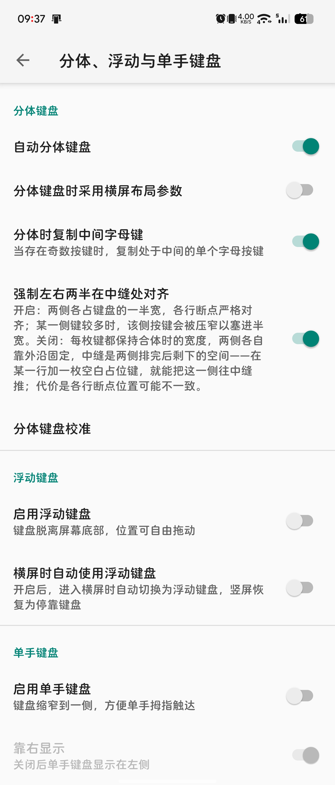
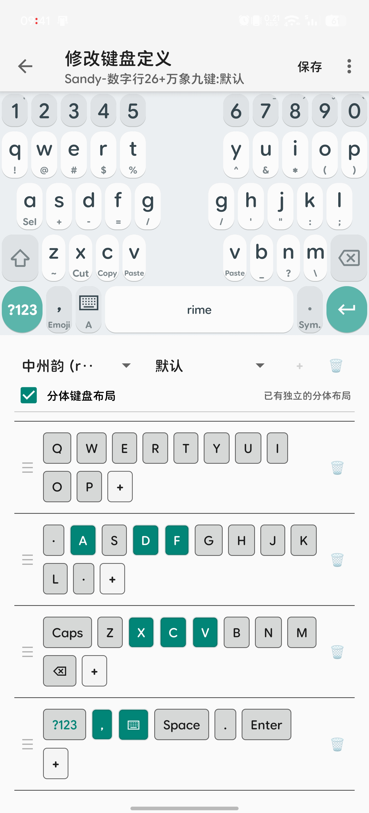

# 分体键盘

屏幕宽度较大的场景（平板、折叠屏展开、横屏）下，键盘左右分成两半，各放一半按键，便于双手握持设备时两根拇指同时输入。

## 启用与配置

入口统一在 **应用主页 → 键盘 → 分体、浮动与单手键盘 → 分体键盘**：

- **自动分体键盘**（默认开启）：键盘实际宽度（dp）达到分体阈值时自动启用；关闭后始终不分体；
- **分体阈值**：首次安装时按设备类型设定（平板 420、折叠屏 440、标准手机 470、小屏手机 500、大屏手机 520 dp，识别不到时为 470），只在「分体键盘校准」页里调整；
- **分体键盘校准**：可视化校准当前屏幕下的分体阈值与中缝间隙（默认 20%，可调 5–60%），也可一键套用按设备类型给出的推荐值；
- **分体键盘时采用横屏布局参数**（默认关闭）：按横屏的边距、高度参数渲染，更适配大屏；对折叠屏内屏竖持同样生效；
- **分体时复制中间字母键**（默认开启）：`asdfghjkl` 这类奇数字符行分体时，把几何中间的字母复制成两枚、两半各一枚（如 `asdfg‖ghjkl`），只对**纯字符输出**的字母键与宏键生效；
- **强制左右两半在中缝处对齐**（默认开启）：见下文，关闭可让按键保持原有宽度。

后四项只在「自动分体键盘」开启时可用。工具栏或状态区还可以自行添加「分体键盘」按钮（默认按钮布局不预置），一键切换「自动分体键盘」开关；是否真正分体仍取决于键盘宽度与阈值。

## 智能默认

本版提供智能默认值，多数设备无需手动校准即可获得合理分屏体验；不满意再用校准功能调整。

## 键宽与中缝：两种对齐策略

- **强制对齐（默认）**：两侧各占一半宽度、上下行断点严格对齐；代价是键多的那一侧按键会被**压窄**。
- **关闭强制对齐**：两侧各自靠外沿固定，**每枚键保持布局文件里写的宽度**，中缝变成两侧排完后**挤剩下的空间**——各行断点可能不齐，但按键不再变窄。

关闭对齐后，还可以用**空白占位键**（`PlaceholderKey`，只占位、完全不可交互）把某一侧往中缝方向推：占位键占多宽就把那一侧整体推多远。含空格键的分体行由空格承担中缝；勾选“本行保持连在一起”的行直接按整行排列。

## 按方案单独配置分体布局

在**键盘布局编辑器**里勾选方案下拉框下方的 **「分体排列」**，可以为「当前选中的那个子布局」（默认布局或某个方案）单独配一套分体排列；磁盘上写在对应子布局里与 `default` 并列的 `__variant__:split` 保留键中，没配过的方案自动沿用「默认」那份分体布局。

## 指定断点

在「键盘结构」的行设置里选择 **「分体断点」**（自动，或在第 N 键之后），或在完整按键设置里勾选 **「分体键盘在本键之后断开」**，可指定该行的断点（同一行勾多个以最后一个为准）；有该标记的行**不再自动复制中间键**——手动分界与自动复制互斥。

## 让某一行保持连在一起

1. 在布局编辑器选好方案或默认子布局，勾选“分体排列”。
2. 在“键盘结构”打开目标行的设置，勾选“本行保持连在一起”。
3. 确认并保存布局，观察分体预览，再到实际键盘验证。

该行按整行渲染，不应用左右断点，也不自动复制中间字母键；其他行继续按分体排列显示。取消后恢复该行的分体策略。此选项适合需要连贯显示的功能行或底行。

JSON 中用该行**第一个按键**上的 `"splitRowDisabled": true` 表示行设置，省略或 `false` 表示允许分体。编辑器会维护标记位置；手改时不要放到行内其他按键或 `composeOverride` 中。普通非分体排列不受此字段影响。

## 相关页面

- [分体、浮动与单手键盘](/features/keyboard/keyboard-modes) —— 全部开关、默认值与形态之间的关系
- [浮动键盘](/features/keyboard/float-keyboard)
- [键盘布局编辑器](/features/editor/layout-editor)
- [调整模式](/features/keyboard/adjust-mode)
