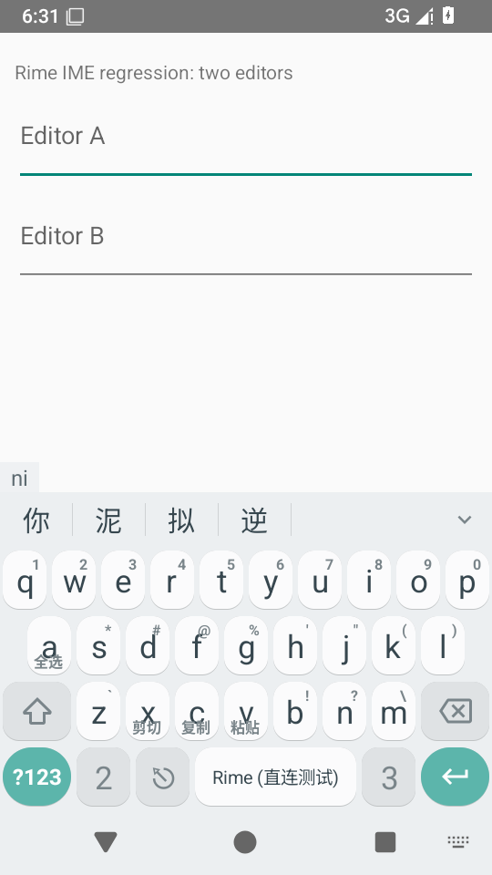

# ClearURLs 规则、后台处理与同步一致性 · 2026-10-25

[来源与散列记录](./provenance.json)。

运行基准 [`e146d2cb`](https://github.com/SandyYuR/fcitx5-android/commit/e146d2cbd5eb4841b258825be965b5b8c92d30ed)，分支 `perf/direct-rime-startup-20261024`。本批关闭旧报告 D11，原 139 条对照剩 10 条需处理、3 条待验证。

## 修复

- 原 APK 缺少规则文件，过滤始终返回原文。现在固定 ClearURLs/Rules 的 `11086f40`，原样打包 206 个 provider、LGPL3 与 GPL3 文本，附[来源及校验值](./rules-source.json)。
- 元数据查询只报告内置能力，不打开规则；首个 URL 在工作线程同步完成初始化和过滤后入库，先于插件执行。无需等待远程服务连接。普通文本不加载规则。
- 同步任务在 Main 只排定顺序，过滤、去重与持久入队在 IO；网络排空不阻塞下一次复制入队。取消排队任务不产生新读写，空/已销毁远程服务释放全局插件回调。
- 删除共享的可变 QuerySanitizer。按编码后的真实 `&` 分割，只解码参数名，保留未删除值的原始转义、重复参数、空值、等号及顺序。修复 `%26`、`%2526` 等值变成参数分隔符的问题。
- 同步回流判断兼容旧版本保存的原始 URL；接收策略仍先检查原文，随后使用一致的过滤结果入库/更新系统剪贴板，IPC 原始文本仍保留。显式手动上传可继续执行。
- 处理超出 65,536 个 UTF-16 单元的文本时保留原文；重写未在 8 次内达到稳定结果时也保留原文，避免多段过滤逐步改变同一 URL。
- APK 验证强制检查固定规则内容、来源、许可证；规则只从 APK 读取，不复制到 native Rime 数据目录。CI 新增包校验的正/负例测试。

本批亦移除了同步拉取路径中的剪贴板正文调试日志。

## 本地验证

[完整 953 项应用 JVM 测试](./jvm-summary.json)、6 项构建逻辑测试通过，失败/错误/跳过均为 0；相对 4bb3486c 新增 56 个应用执行。包括 API23/28 框架、Native SQLite 的首次系统复制无插件入库及插件顺序、100 个并行 URL、旧状态回流、后台任务顺序/取消及服务回调释放。

[4 项 Python 包校验测试](./packaging-tests.txt)通过，覆盖正确资产、缺许可证、规则内容变化和错误复制到 Rime 数据目录。[APK 核验](./apk-verification.json)通过：22 个 dex、16 KiB 对齐、无 Fcitx native 后端，包内规则与来源匹配。

## 模拟器

[API35 Android 原生测试](./android-tests.txt)两项通过：

1. 实际 Android 正则实现编译规则库；后台过滤验证编码值、Google 重定向、Amazon 路径和联盟参数。
2. 原输入界面 6 轮真实触屏 N/I、候选“你”及 restartInput 重绑，逐轮正确提交，未重复提交。[原始轮次数据](./touch-rebind.json)。

使用 AOSP x86_64、TCG/SwiftShader，无 KVM。测试采用 bundled-smoke 微型词典，未映射万象模型；数据包含触摸注入、等待和轮询，不作为真机帧延迟、完整模型性能或优化前后对比。执行后 crash 缓冲区为空。

4bb3486c 的候选菜单、方案列表、镜像导航及其历史失败仍见[前一批记录](../sync-candidates-2026-10-25/index.md)。旧英文模式提示异常、无点按程序化密码类型切换的显示前置条件仍待专项定位；本批未以 URL 过滤检查覆盖它们。

## 远端安装包

[CI 40219854407](https://github.com/SandyYuR/fcitx5-android/actions/runs/40219854407)已成功，应用 JVM、Python 包校验与签名 ARM64 Release 构建通过。[下载当前 ARM64 Release](https://github.com/SandyYuR/fcitx5-android/actions/runs/40219854407/artifacts/12608557908)。尚无该 Release 的 ARM64 真机装机验收。
