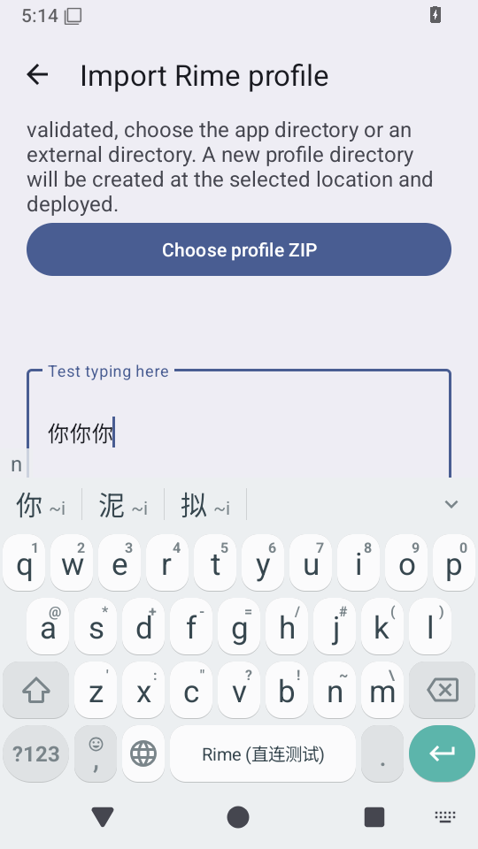
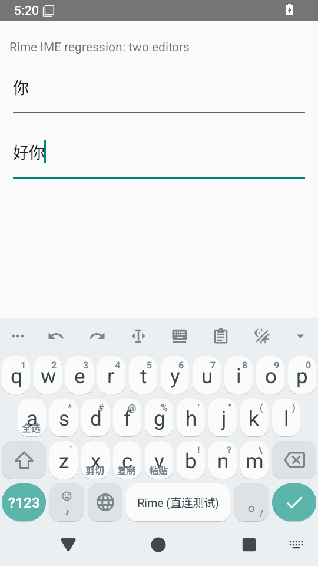

# Rime 直连版模拟器回归 · 2026-10-25

代码目标为修复分支 `ea6229a4`，安装的是 x86_64 Debug APK，版本名也为 `ea6229a4`。后端直接加载 `libdirect-rime.so`。

## 环境与准备

Android 15 / API 35 AOSP x86_64；宿主没有 KVM，使用 TCG 与 SwiftShader，2 核、1536 MiB 客体内存。冷启动出现过 System UI 无响应；将 `ro.hw_timeout_multiplier` 设为 10 后重启 Android 框架，等待用户存储解锁。测试目录按应用 UID 修正所有权，使用独立的微型测试词库，不包含真实用户数据。

测试 APK 的构建标签为 `26a0c90f`，目标应用 APK 为 `ea6229a4`；两提交之间 `app/src/androidTest` 源码没有变化。构建标签、APK 哈希及环境见 [来源记录](./provenance.json)。

## 实际结果

| 设备侧测试 | 结果 | 记录 |
| --- | --- | --- |
| 候选、方案与编辑器接口契约 | 通过 | [日志](./native-contracts.txt) |
| 原键盘模式提示与触屏综合场景 | 未通过：英文模式提示未显示 | [失败栈](./mode-hint-failure.txt) |
| 真实触屏与连续编辑器重绑 | 6 轮通过：输入 ni、点选“你”、累计上屏，无重复提交 | [日志](./touch-rebind.txt)、[逐轮记录](./touch-rebind.json) |

触屏回归中的实际画面：编辑框已上屏三次“你”，键盘继续输入，候选栏显示“你、泥、拟”。

## 独立宿主中的编辑框切换

通过 ADB 触屏操作独立的双编辑框宿主：A 输入 ni 后选“你”，切到同输入类别的 B 输入 hao 后选“好”，对 B 执行 `restartInput` 后再输入 ni 并选“你”。最终 A 为“你”、B 为“好你”，宿主只记录到对应的三次提交，未串到另一个编辑框。[宿主提交记录](./two-editors.json)。该场景未注入语音插件回调或宏取消。

## 尚未确认的模式提示异常

综合场景停在 `English-mode hint was not displayed in the preedit area`，尚未执行该场景后面的触屏断言。后续独立重绑场景通过了触屏和候选上屏，不能据此把前一场景写成通过。

源码的提示在引擎侧 1500 ms 后清除。此次软件仿真存在长时间类校验和首次视图加载，是否导致提示在界面消费前过期仍需进一步定位。需在 KVM 模拟器或真机复测，并记录面板事件的界面消费时序；当前没有据此修改生产代码。

## 验证边界

以上是模拟器的实际功能结果；694 项 JVM 单测另行统计。逐轮记录包含注入、轮询及仿真开销，不用于计算真机延迟或提速百分比。本次没有验证 ARM64 Release 装机、万象大词库、真实语音插件、宏取消的设备行为、完整锁屏开机或断电恢复。
