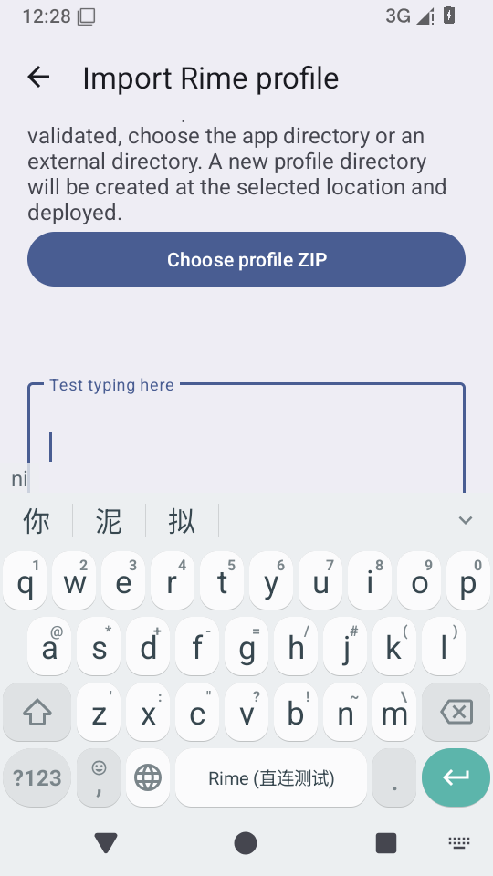

# 布局编辑返回结果与重建恢复 · 2026-10-26

运行代码 `6f96066b`，分支 `perf/direct-rime-startup-20261024`，最终测试来源 `b193b9ff`。[来源与验证](./provenance.json)。

## 修复内容

- 普通按键和辅助栏按键返回时，先保存结果，等布局、草稿、撤销基准和界面恢复后再应用。内部子页面带原文件、原条目及一次请求令牌，拒绝错位、过期和重复返回。
- 布局命名、文件命名、图片导入和扫码也使用等待队列；外部图片仅保存 URI。应用某个结果启动重新加载时，后面的结果继续等待。
- 内嵌宏、颜色和组合键编辑结果改存可 Parcel 的数据，替换仅存内存的闭包。再次重建发生在加载完成前时，保留原选择、原表单和已经返回的结果。
- 重建始终恢复该编辑器原来的文件，即使全局使用的布局配置已经变化。返回结果可撤销，撤销保留原有未保存草稿；不隐式保存布局文件。

## 框架与打包验证

[983 项完整应用 JVM 测试](./jvm-summary.json)、6 项构建逻辑、[4 项 Python 包校验](./packaging-tests.txt)通过。布局修复新增 28 个 API23/28 执行覆盖队列一次消费、取消、错令牌、旧结果、连续 Parcel、命名子页面实际返回协议、颜色清除与宏/组合键结果恢复。

[APK 核验](./apk-verification.json)：22 个 dex，16 KiB 对齐，只有 direct-rime/c++ 原生库，固定 ClearURLs 规则与来源匹配。

## 设备验证

最终 [组合回归 3 项](./final-combined.txt)与[独立输入复跑 1 项](./final-isolated.txt)全部通过，共 4 次执行、3 个不同方法。普通/辅助按键返回、原文件/条目、再次重建前的内嵌颜色与表单选择、原草稿与撤销检查均通过。

输入部分共 12 轮真实触屏 N/I、候选“你”及 restartInput 重绑，提交次数正确，无额外提交。[组合六轮原始数据](./touch-combined.json)、[独立六轮原始数据](./touch-isolated.json)，实际 DOWN/UP 代号均一致；候选按住时间分别为 88–209 ms、85–141 ms。[最终 crash 缓冲区为空](./final-crash.txt)。

早期[联合首键失败](./android-tests.txt)、[独立候选提交失败](./input-isolated.txt)及后续诊断全部保留，最终通过不替换原始记录。

第一轮夹具只创建辅助栏按键，没有启用辅助栏位置/尺寸，导出未包含这些按键，导致两项测试在初始字段/数据前置条件失败。[原始失败](./first-invalid-fixture.txt)保留；e7a696fe 补全配置并增加加载前置检查后，[两项通过](./fixture-corrected-tests.txt)，[crash 缓冲区为空](./fixture-corrected-crash.txt)。未将夹具失败认定为产品崩溃。

使用 API35 AOSP x86_64、TCG/SwiftShader，无 KVM。加载窗口由测试显式设定，父页面重建、子页面返回和撤销使用实际 Android 实现；不是实际系统杀进程验收。旧英文模式提示异常与无点按程序化密码类型切换问题仍保留在前批审计中。

## 触屏注入诊断与修正

[带现场诊断的原始失败](./input-diagnostics-failed.txt)、[原始数据](./touch-failure.json)显示：引擎仍就绪，输入会话始终为 4，预编辑 ni、编辑框为空；测试在等待候选点击提交。测试原想按住 20 ms，但同步等待 DOWN 返回，实际时长为：

| 触点 | DOWN 到 UP |
| --- | --- |
| n | 547 ms |
| i | 483 ms |
| 你 | 331 ms |

候选的按住判定默认 300 ms。新增框架测试在 API23/28 验证了 20 ms 会点击、331 ms 会进入候选按住/长按回落；完整本地 JVM 增至 983 项。`1c96acd9` 改为 DOWN 异步入队、UP 同步排空，保留原首键/候选/提交断言，并记录每次触点实际时长。修正后组合与独立复验均通过，原始记录见上节。

原始 JSON 的 target_apk_commit 来自 AndroidTest 编译时内联的 BuildConfig，516252eb 表示编译基线；实际安装版本已独立查询为 6f96066b。修正后的记录同时写测试来源与实际目标包版本，APK 散列见来源文件。

继续诊断[首 n 断言](./first-key-before-binding-check.txt)时，[记录](./first-key-before-binding-check.json)出现查找触点前的代号 21 和失败时的 24；对齐[系统日志](./binding-lifecycle.txt)，真正的绑定 24 在单调时间 3922.489 已发生，早于 DOWN 的 3926.142。因此该变化本身不能证明实际注入使用了旧会话，首 n 的单独根因仍未证明。`b193b9ff` 补查实际 IME 的目标包/字段/输入类型与 onStartInput 计数，重绑也确认对应回调；代号改在实际 DOWN/UP 采集。保留原输入断言与超时，没有增加引擎预热或等待 native ready。

最终目标安装包仍为 6f96066b；后续只改测试，AndroidTest 重编译复用未变化的 Main 编译结果。最终测试 APK 散列与编译基线也单独记录，不能把 AndroidTest 内联常量当作实际安装包版本。

## 远端安装包

[CI 40247691050](https://github.com/SandyYuR/fcitx5-android/actions/runs/40247691050) 的单元测试、Python 包校验和签名 ARM64 Release 构建均通过。[下载 ARM64 Release](https://github.com/SandyYuR/fcitx5-android/actions/runs/40247691050/artifacts/12619626685)，对应运行代码 6f96066b。后续 516252eb 扩展再次重建检查，1c96acd9 修正触点注入与记录，b193b9ff 补查实际绑定；均只改测试代码。测试源码与两个 APK 散列见来源记录。ARM64 Release 尚未做真机安装验收。
