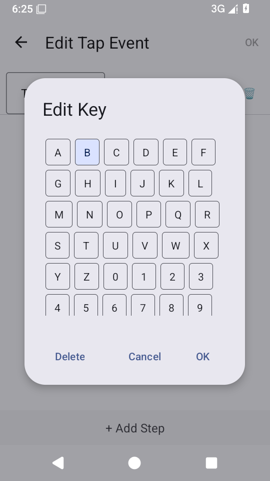
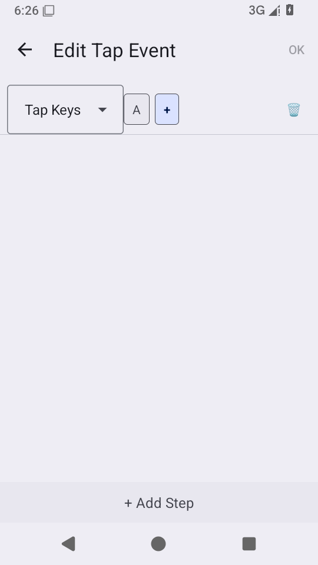
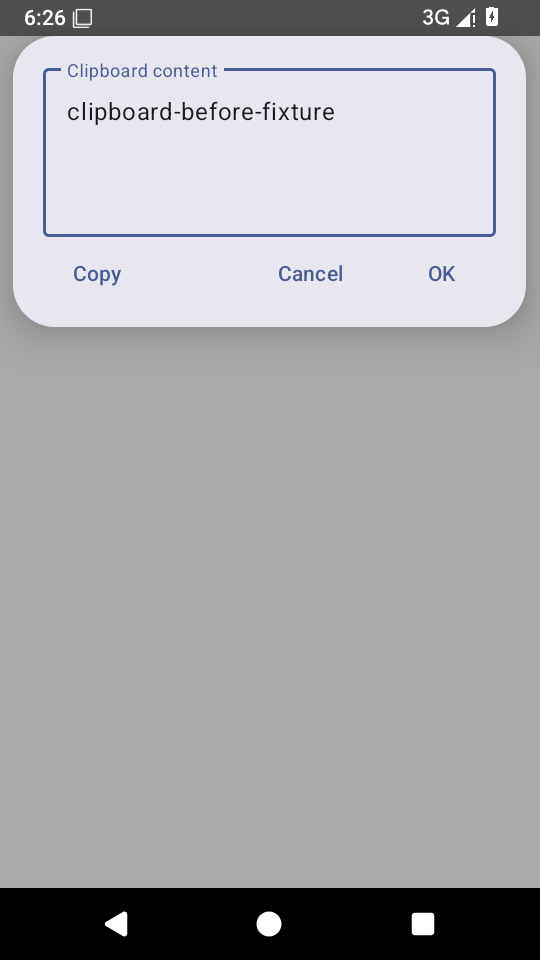
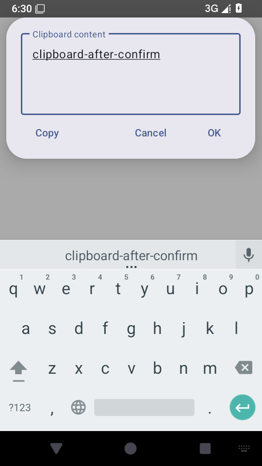
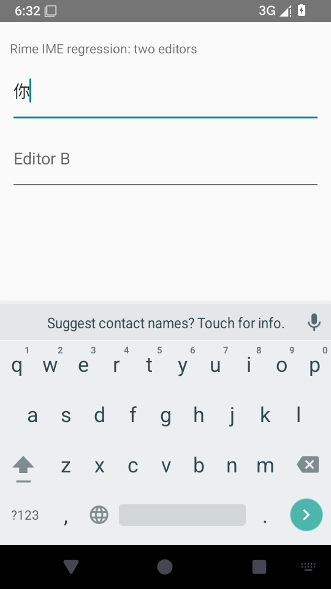

# 宏与剪贴板编辑：模拟器手动检查 · 2026-10-25

## 构建与边界

目标 APK 为提交 `b2c4631a` 的 x86_64 Debug，包名 `org.fcitx.fcitx5.android.fx.rime.debug`。后端为直接调用 librime，历史命名空间不代表仍使用 Fcitx 原生后端。[来源与 APK SHA-256](./provenance.json)、[APK 依赖核验](./apk-verification.json)、[界面与数据库结果](./results.json)。

API 35 AOSP、TCG 软件模拟、SwiftShader、无 KVM。这是手动操作真实 Activity 的检查，不是新增 instrumentation 通过数，也不用于推算真机性能。ASCII 测试文本使用 AOSP 键盘输入，避免将任意测试文本受 Rime 组词影响。

## 宏编辑

1. 从 JSON 打开原有 A 按键：未编辑时右上 OK 灰色。
2. 打开按键选择框，确实选中 B（蓝色）。
3. 点击 Cancel，返回后仍显示 A，OK 保持灰色，取消未修改原数据。

重复相等键的按身份删除、返回键/点击外部取消、JSON 各步骤类型和旧格式规范化另有 API 23/28 框架测试。

## 剪贴板保存

使用模拟器中专门插入的测试行（id=1），不读取真实用户剪贴板：

| 阶段 | 实际内容 |
| --- | --- |
| 打开浮窗 | `clipboard-before-fixture` |
| 修改草稿，尚未确认 | 编辑框为 `clipboard-after-confirm`；SQLite 仍为旧值 |
| 点击浮窗 OK | 保存后浮窗关闭；原生 SQLite 查询为 `clipboard-after-confirm` |

## 尚未完成的设备场景

延迟写入期间关闭浮窗的补充检查，准备阶段未成功到达目标编辑框，已在加锁或保存前中止；之后模拟器进程退出。本轮不把它算作设备侧通过或应用缺陷。真实 Room/Native SQLite 的受控延迟 JVM 测试已覆盖 Activity 销毁后继续保存、失败保留草稿、新旧 Intent 结果隔离及重复确认。

[上一轮设备回归](../direct-rime-2026-10-25/index.md)的英文模式提示断言失败仍待查；本轮编辑界面通过不覆盖该异常。仍无真机、minified ARM64 Release 装机或进程强杀后草稿恢复验收。
