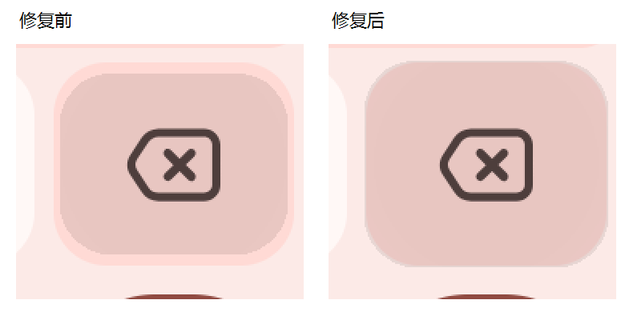

# 2026-11-26 按键按压高亮轮廓验证

## 结果与根因

开启按键点击涟漪时，旧实现的按压高亮比实际键帽向内缩小一圈。实际绘制链为 `KeyView.appearanceView.foreground` → `RippleDrawable`：激活填充和遮罩本来都含有横纵内边距，但默认的嵌套 padding 又将激活层的内边距应用到遮罩层，造成重复内缩。

修复把涟漪各层切换为 `LayerDrawable.PADDING_MODE_STACK`，共用按键坐标；普通键的高亮形状同时使用与键底一致的全局边框及单键 `Border.On` / `Border.Off` 判定。胶囊和空格键保留自己的显式几何。主题颜色未改。

## 版本与范围

- 设备验证基线：`c1307b794f6376977e17145c0a24b433f952e0bc`。修复提交：[ceecdf1588c9ee30b8bbe9b32883342a8e04bd72](https://github.com/SandyYuR/fcitx5-android/commit/ceecdf1588c9ee30b8bbe9b32883342a8e04bd72)。
- 首轮设备验证在隔离工作区 `fix/key-press-highlight` 完成；源码改动为 `KeyView.kt` 和新增 `KeyPressHighlightGeometryTest.kt`。相同两份文件同步到主工作区后，在另一任务已提交的 `b73552da24bf06ea204cb18cdd5ddd801d6069be` 上完成最终集成验证；未修改该任务内容。
- 隔离验证包 ABI 为 x86_64，Debug 包名 `org.fcitx.fcitx5.android.fx.rime.debug`，versionCode 114。
- 修复 APK SHA-256：`604c99b2aaa2ba0f7c4e95a035bf0e7b1d668b7a09544ea362c62e685f471001`。APK 包含上述基线加本次补丁；此处基线 SHA 不包含该补丁，须结合<a href="/fcitx5-android/maintainer/audit/key-press-highlight-2026-11-26/keyview.patch" download>源码补丁</a>及[测试快照](./KeyPressHighlightGeometryTest.kt.txt)复现。
- 本页记录本机验证。最终集成 APK 未再次安装，设备图片对应上面的隔离基线和相同源码补丁；其他 ABI、真机及所有主题不在本机验证范围内。提交后的远端结果以该提交的 GitHub Actions 为准。

## 自动化验证

Native Robolectric 在 SDK 28、35 使用真实 `KeyView`，按 120 × 72 px 布局后，让实际前景层分配 bounds，再比较键帽填充、按压遮罩和激活填充的 alpha 轮廓。横纵间距分别为 5、9 px，以暴露重复内缩；比较填充时剔除阴影和描边，统一使用不透明白色排除颜色量化影响。

| 记录 | 执行数 | 失败 | 错误 | 跳过 |
| --- | ---: | ---: | ---: | ---: |
| [旧实现初版轮廓测试](./geometry-old-junit.xml) | 12 | 10 | 0 | 0 |
| [修复后最终轮廓测试](./geometry-fixed-KeyPressHighlightGeometryTest.xml) | 14 | 0 | 0 | 0 |
| [既有透明键水波纹遮挡测试](./geometry-fixed-WaterRippleOcclusionTest.xml) | 12 | 0 | 0 | 0 |

终版增加了描边分支等覆盖；旧版计数对应当时的初版测试，不能当作同一份终版测试的逐项对照。覆盖普通键、单键强制开关边框、描边、胶囊、无边框空格、主题刷新及透明占位键。<a href="/fcitx5-android/maintainer/audit/key-press-highlight-2026-11-26/geometry-fixed-test.log" download>目标测试日志</a>保留实际执行过程。

相同两份源码同步到主工作区后再次执行这两组测试：轮廓测试 14/0/0/0、透明键测试 12/0/0/0，均实际执行且未跳过；<a href="/fcitx5-android/maintainer/audit/key-press-highlight-2026-11-26/geometry-main-integration-test.log" download>集成测试日志</a>保留过程，[JUnit 核对摘录](./geometry-main-junit-observation.txt)保留当时读取的测试套件头部。主工作区报告目录随后被并行测试刷新，未保存该次完整 XML；隔离工作区的完整 JUnit 已保存在上表。两处 `KeyView.kt` 的 SHA-256 均为 `8c24accf27f813506ab296f6ec5c1b3de08ee7ca5635b6cad51c0fe4e07e12e6`，两处新测试源码均为 `b9cb0af67d15817a7c0b2de26f28b46660737a3e568308f5abc02d5652d67ab5`。

Debug 构建成功；<a href="/fcitx5-android/maintainer/audit/key-press-highlight-2026-11-26/geometry-apk-gate-0.log" download>APK 白名单记录</a>、<a href="/fcitx5-android/maintainer/audit/key-press-highlight-2026-11-26/geometry-apk-gate-1.log" download>链接审计记录</a>及<a href="/fcitx5-android/maintainer/audit/key-press-highlight-2026-11-26/geometry-apk-gate-2.log" download>APK 摘要记录</a>保留原始输出。链接审计使用本次隔离工作区的 `app/.cxx` 和 `native/rime-sdk`。原生 ELF build ID 为 `e846e537052865341f5d38e0709708fe774d0b92`。

## 提交前最终集成验证

在 `b73552da24bf06ea204cb18cdd5ddd801d6069be` 加同一补丁的主工作区执行相关测试，`BUILD SUCCESSFUL in 59s`。以下为实际完整 JUnit，失败、错误、跳过均为零：

| 测试 | 执行数 | 完整记录 |
| --- | ---: | --- |
| 高亮轮廓 | 14 | [JUnit](./geometry-final-KeyPressHighlightGeometryTest.xml) |
| 透明键水波纹 | 12 | [JUnit](./geometry-final-WaterRippleOcclusionTest.xml) |
| 文本图标按键集成 | 6 | [JUnit](./geometry-final-IconTextKeyViewTest.xml) |

最新 x86_64 Debug <a href="/fcitx5-android/maintainer/audit/key-press-highlight-2026-11-26/geometry-final-build.log" download>构建成功</a>（24 s），APK SHA-256 为 `bca32433b848adc0d92ceb3a835e195df4a38e5ea6aa8344d9a8c37a0fb66868`；<a href="/fcitx5-android/maintainer/audit/key-press-highlight-2026-11-26/geometry-final-apk-gate.log" download>APK 白名单</a>和<a href="/fcitx5-android/maintainer/audit/key-press-highlight-2026-11-26/geometry-final-link-gate.log" download>原生链接审计</a>通过。审计匹配主工作区实际 `app/.cxx`、`native/rime-sdk` 和本次 APK，ELF build ID 为 `c4a7070ea2b1cbd561dcd69db81d216f4a3d31d0`。这份集成包与上文用于设备前后对比的隔离包分别保留摘要，不互相替代验证范围。

代码提交后的 [Commit CI](https://github.com/SandyYuR/fcitx5-android/actions/runs/45779421012) 已完成：全量 JVM 单测、arm64-v8a / armeabi-v7a / x86 / x86_64 四个 Release 构建及 Nightly 发布均成功。远端构建结果不扩大下文设备验证的范围。

## 模拟器实际按压

设备为唯一的 `rime` AVD，序列号 `emulator-5574`，AOSP API 35 / x86_64，截图分辨率 1080 × 2280。主题为 Caramel Dawn，布局为 Sandy-数字行26+万象九键；按键边框、描边、点击涟漪、特殊键胶囊均开启。

在同一短信输入页面，对退格键中心 `(1000, 1930)` 原地按住 2500 ms，在约 1000 ms 时截取按压状态。旧版和修复版采用同一动作、主题、布局和坐标，未发送短信。

图片由[旧版原始截图](./geometry-pressed-before.png)和[修复版原始截图](./geometry-pressed-after.png)裁剪拼接；两侧均裁剪 `(900, 1855, 180, 160)`，以最近邻放大 2 倍。它是模拟器实际帧，不是组件渲染。

在原始截图的 `x = 1000` 列，旧版 `y = 1867..1873` 与 `1987..1993` 留有原键色 `#FFFFDAD5`；中部高亮为 `#FFE8C6C1`。修复后 `1867..1907` 和 `1954..1993` 均为高亮色，键帽内的粉色留白环消失；最外侧 `1866 / 1994` 是抗锯齿过渡。

## 数据保护与限制

安装使用同包原签名 `adb install -r`。首次安装返回 Success 后模拟器意外退出，随后通过既有启动脚本重启同一 AVD；未清空数据、卸载或创建替代 AVD。重启后应用登记一度缺失，同包再次覆盖安装后恢复；默认输入法已恢复 Fcitx。

设置快照按 XML 键逐项比较：主题、布局、剪贴板限制、候选角标及按键选项均保持原值。差异只有运行时 `pid` 和被删除的旧 `navbar_background=Full`；既有 `ThemePrefs` 在 API 35 初始化时会删除这一键，默认仍为 Full。未为此回写整个设置文件。原短信框中的临时测试字符在重启期间丢失，未发送短信。

提交前主会话复查生产 diff、测试源码及执行记录，未发现阻塞性问题。独立复核未取得有效结论，顾问工具另返回 `advisor-stall-timeout`，均不计作验收通过；运行结论依据上述实际执行测试、APK 审计与模拟器前后帧。

## 附件

- <a href="/fcitx5-android/maintainer/audit/key-press-highlight-2026-11-26/keyview.patch" download>源码补丁</a>、[轮廓测试源码快照](./KeyPressHighlightGeometryTest.kt.txt)。
- <a href="/fcitx5-android/maintainer/audit/key-press-highlight-2026-11-26/geometry-old-test.log" download>旧版测试日志</a>、<a href="/fcitx5-android/maintainer/audit/key-press-highlight-2026-11-26/geometry-fixed-first-test.log" download>首轮修复测试日志</a>、<a href="/fcitx5-android/maintainer/audit/key-press-highlight-2026-11-26/geometry-fixed-test.log" download>最终目标测试日志</a>、<a href="/fcitx5-android/maintainer/audit/key-press-highlight-2026-11-26/geometry-build.log" download>Debug 构建日志</a>。
- [旧版 JUnit](./geometry-old-junit.xml)、[修复版轮廓 JUnit](./geometry-fixed-KeyPressHighlightGeometryTest.xml)、[透明键 JUnit](./geometry-fixed-WaterRippleOcclusionTest.xml)。
- <a href="/fcitx5-android/maintainer/audit/key-press-highlight-2026-11-26/geometry-apk-gate-0.log" download>APK 白名单</a>、<a href="/fcitx5-android/maintainer/audit/key-press-highlight-2026-11-26/geometry-apk-gate-1.log" download>链接审计</a>、<a href="/fcitx5-android/maintainer/audit/key-press-highlight-2026-11-26/geometry-apk-gate-2.log" download>摘要</a>。
- [修复前按压帧](./geometry-pressed-before.png)、[修复后按压帧](./geometry-pressed-after.png)、[局部对比](./geometry-before-after.png)。
- <a href="/fcitx5-android/maintainer/audit/key-press-highlight-2026-11-26/checksums.sha256" download>附件摘要</a>。

相关契约：[键帽与按压高亮](../../implementation/design-system#键帽与按压高亮)。
