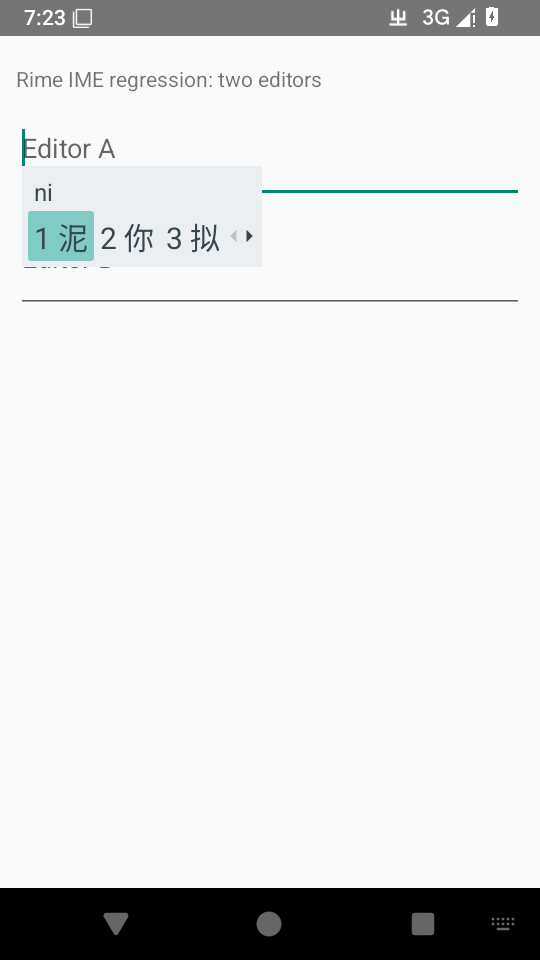

# 关机后的用户词典持久化 · 2026-10-27

运行代码 [8dca031c](https://github.com/SandyYuR/fcitx5-android/commit/8dca031c80fdf6c82015982b54385ef8bea12d48)，[测试探针 93942a2e](https://github.com/SandyYuR/fcitx5-android/commit/93942a2e)。API35 AOSP x86_64 Debug、无 KVM；发行和 CI 仍只构建 ARM64。当前程序直接调用 librime，未加载 Fcitx 后端。[来源与环境](./provenance.json)

## 实际操作与结果

1. 独立小词表中输入 `ni`，原排序为“你、泥、拟、逆”；实际选择“泥”后，再输入确认其已成为首选。保持引擎连接，不主动执行保存或结束测试。
2. [关机前记录](./before.json)确认原生进程 PID4355 存活，尚无用户词典同步导出文件。宿主执行 `svc power reboot`，发送正常关机广播。
3. [系统日志节选](./shutdown-system-excerpt.txt)中，18:42:55 开始发送关机广播，18:42:58 应用接收并执行保存，18:43:07 内核重启。[学习阶段日志](./learn-interrupted.txt)因系统关机而按计划中断，不算作一项完成的 JUnit 测试。
4. [重启后、校验前记录](./after-boot.json)确认内核 boot ID 改变，并已有包含“泥”的用户词典同步导出。恢复软件模拟器的超时和 FUSE 挂载时没有修改词典文件。
5. 新原生进程 PID2410、boot_count 从13增至14，重新输入 `ni` 的候选仍为“泥、你、拟、逆”。[校验阶段日志](./verify.txt)一项通过；[完整读回结果](./verified.json)。

P1-10 在本次模拟器正常关机场景验证通过。本结论限于小词表的功能持久化；不证明 ARM64 真机、大词典维护、突然断电或所有厂商的广播期限。软件模拟器使用放宽的系统超时，耗时不能作为真机性能指标。
