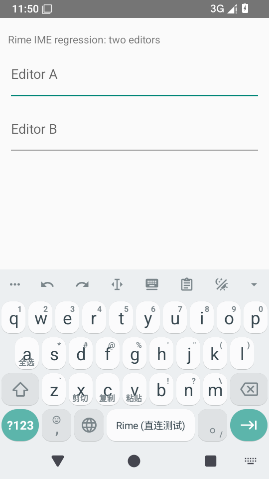
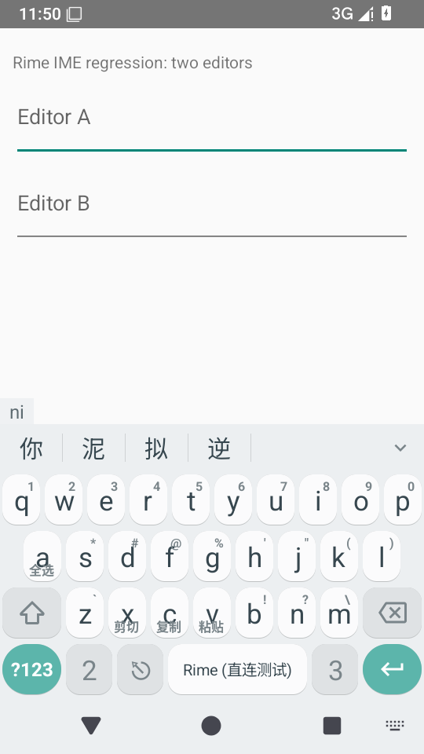
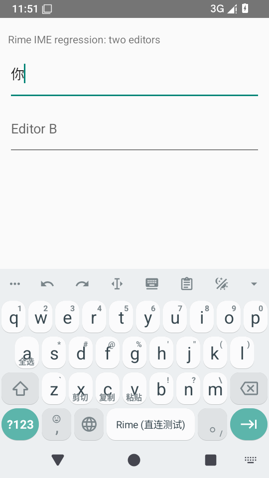

# 输入法切换后的旧布局任务崩溃 · 2026-10-25

## 设备发现

在 `b2c4631a` x86_64 Debug 的 API 35 AOSP 模拟器上，切到 AOSP 输入法再切回 Rime 直连版时，旧服务的排队布局回调触发主线程崩溃。[原始异常栈](./before-fix-crash.txt)。异常类保留历史 Fcitx 命名，当前后端仍是 librime 直连。

崩溃点为 `KeyboardWindow.switchLayout` 的 Main Executor 回调；服务已断开后，回调仍读取 `inputMethodEntryCached`，抛出 `FcitxDisconnectedException`。模拟器无 KVM，慢 UI 扩大了回调与服务销毁交错的窗口；异常栈对应实际执行，不将绝对耗时外推真机。

## 修复

提交 `1c8a7d04` 将布局切换、字体完成和延迟字体刷新统一交给 Service 生命周期下的主线程任务；执行前核对所属 InputView 仍是当前视图。服务销毁后自动取消，主题换视图后丢弃旧任务；字体完成闭包不再在旧依赖作用域中查找服务。

仍保留排队和 FIFO 顺序，未以同步执行来绕过问题。未把候选长按菜单或其他异步回调一并宣称修复。

## 验证

新增 API 23/28 共 16 个测试执行：排队与 FIFO、排队后销毁、销毁后字体完成、视图替换、视图移除、新旧视图交错、同视图临时窗口变化及后台线程迟到完成。完整 770 项 JVM 测试通过，失败/错误/跳过均为 0；本轮四批新增 76 个执行。[JVM 汇总](./jvm-summary.json)。

## 修复后设备回归

已安装并核对 `1c8a7d04` x86_64 Debug，APK SHA-256、环境和操作见[来源记录](./provenance.json)，[APK 依赖核验](./apk-verification.json)，[设备数据](./device-results.json)。

清空该测试模拟器的 crash 缓冲区后，执行 3 轮 AOSP→Rime 输入法切换；每轮重新聚焦宿主 A 并调用 restartInput。最后等待键盘实际显示后，通过触屏依次点击 N、I 和第一项候选“你”。宿主文件结果 A=`你`、B 为空，记录恰好一次 commit。结束时应用进程仍在，crash 缓冲区为空，未再次出现旧布局回调崩溃。

该 3 轮操作是设备回归，不代表长期压力测试或真机验收。此前英文模式提示断言异常仍待查，本轮通过不覆盖它。模拟器已保留当前 Rime 直连版输入法和测试宿主，不依赖不可用的快照恢复。
