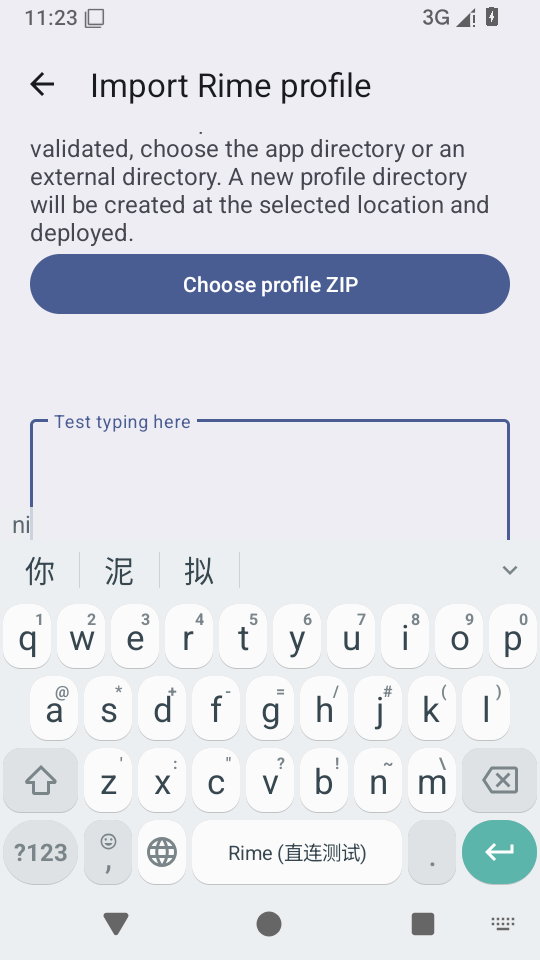
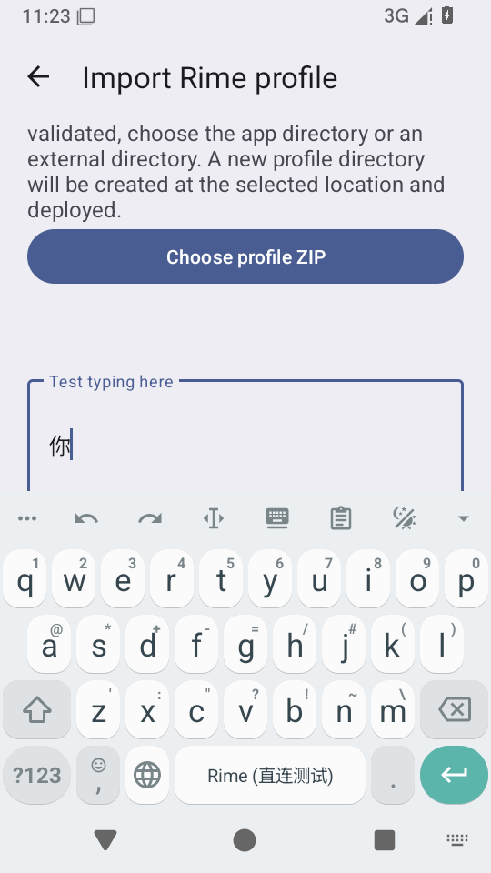
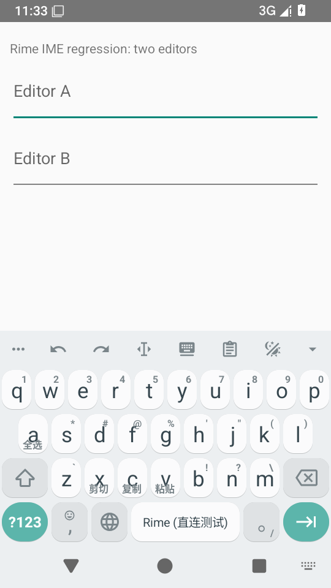

# 英文模式提示在绘制前过期 · 2026-10-27

最终运行代码与测试：[7e5c2c1b](https://github.com/SandyYuR/fcitx5-android/commit/7e5c2c1b0efe5493cf1cbf991ec45f28645ee0ee)。本项为补充发现，不重复计入旧139行。[来源及设备范围](./provenance.json)

## 修复前证据

历史显示断言在209cca0e和9b1f958c再次失败。[209复跑](./before-209-repeat.txt)、[9b1日志](./before-device.txt)、[后端事件及绘制时序](./before-ui-timing.json)。9b1的诊断探针当时尚未提交，后随976ab05f提交；原始JSON的harness字段来自编译时9b1，不当作完整探针源码提交。

提示发出后1554 ms就被后端清除，相关界面第一次preDraw却在3314 ms之后。输入视图的事件处理和显示开关均开启，此时预编辑已为空、540×0。软件模拟器放大了慢UI条件；这些绝对耗时不能当作手机性能数据。

## 分批改动及补充失败

- 976ab05f：独立提示标识、首个可见绘制确认、1500 ms显示期限和未绘制时10秒上限。开始组合、提交、新会话和关闭仍可立即使提示失效。
- 018fcf3e：在Rime专用线程处理确认，传入帧时间，避免owner排队后重新计满1500 ms。该提交的最初界面用例通过，但后续API过期用例失败；未将这次有限通过当作整条确认链路已完成。
- 3ca22462仅改测试：检查真正的匹配标识确认，分开命名键表首次加载与释放键断言。第一次释放断言失败时包含首次加载；[分开后实测](./release-catalogue-timing.json)加载11405 ms、释放61 ms，同为generation3，提示仍保留。[第一次失败](./api-initial-release-failure.txt)
- 同次过期检查仍失败：[原始栈](./api-before-forwarding-failure.txt)。实际API包装类[没有声明新确认方法](./before-api-delegate.txt)，调用落到接口默认空实现。7e5c2c1b改为具名InputEngineApi并显式转发，[最终签名](./after-api-delegate.txt)及三项包装层回归覆盖参数、缓存读取和挂起调用。

普通键盘和浮动候选窗共用PreeditUi；附着窗口且有可见区域时只确认一次。旧标识、重复帧、另一个视图的重复确认或重连前的帧不能持续延长提示。超时只更新面板，不刷新native或重放commit。

## 最终设备回归

同源API35 AOSP x86_64 Debug，无KVM，系统超时放宽。三个独立场景全部通过：

| 场景 | 结果与原始记录 |
| --- | --- |
| 释放、显示后过期、方案提示、输入替换提示、无重复commit、新会话清理 | [API用例通过](./api-expiry-passed.txt)、[释放耗时及会话](./after-release-timing.json) |
| 原键盘英文提示、匹配标识的可见帧确认、实际消失、方案提示、触屏ni及候选“你”上屏 | [界面用例通过](./keyboard-ack-passed.txt)、[帧与确认](./after-ui-timing.json) |
| 编辑器切换与restartInput后立即输入、候选点选 | [用例通过](./touch-rebind-passed.txt)，[六轮实际记录](./touch-rebind.json) |

最终记录中，提示在5230875 ms发出，匹配标识1的可见帧在5238239 ms确认，清除面板在5239895 ms发出：距确认1656 ms，早于未绘制10秒上限。实际执行有调度延迟，确定性用例验证1500 ms期限计算。测试结束后crash buffer为空。

## CI与构建

[最终CI40417349690全绿](https://github.com/SandyYuR/fcitx5-android/actions/runs/40417349690)，[签名ARM64产物](https://github.com/SandyYuR/fcitx5-android/actions/runs/40417349690/artifacts/12696406274)。[CI实际校验输出](./arm64-apk-verification.json)只有ARM64直连Rime及C++库、2个dex、16KiB对齐。

[下载并校验摘要的CI测试报告统计](./ci-jvm-summary.json)：1233项应用测试、零失败/跳过；其中[计时10项](./StatusHintLifetimeTest-ci.txt)、[API包装3项](./InputEngineApiTest-ci.txt)。构建逻辑6项沿用[018本地完整回归](./pre-forwarding-local/jvm-summary.json)，相关源码未变。

本地1GiB完整清理编译发生[编译器堆OOM](./local-1024m-compile-failure.txt)，测试尚未开始，不宣称本地跑完最终1233项。改用2GiB编译堆后，[清理构建通过](./clean-debug-build.txt)，[调试包检查](./emulator-apk-verification.json)后执行上述设备回归。中间976 CI由018续修替代并取消；018虽CI全绿，过期API检查仍暴露了转发遗漏，最终以7e5为准。

设备验证使用小词表，不构成ARM64真机、大词库或手机延迟验收。发行和CI仍仅构建ARM64，本地x86_64仅用于模拟器。

## 当前模拟器

7e5c2c1b直连Debug输入法继续运行，独立双编辑框宿主中显示原键盘；示例方案为小词表。

