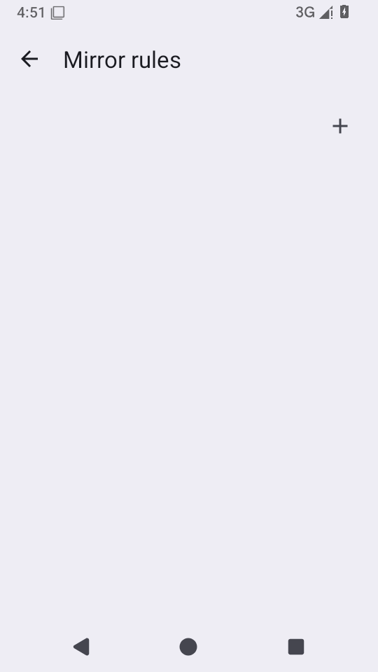
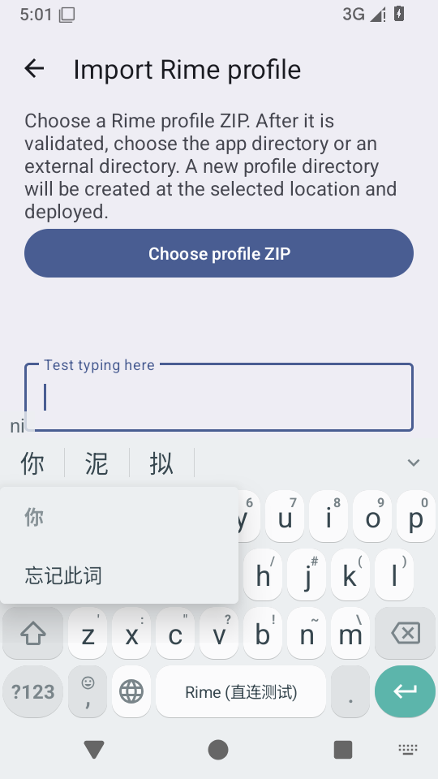
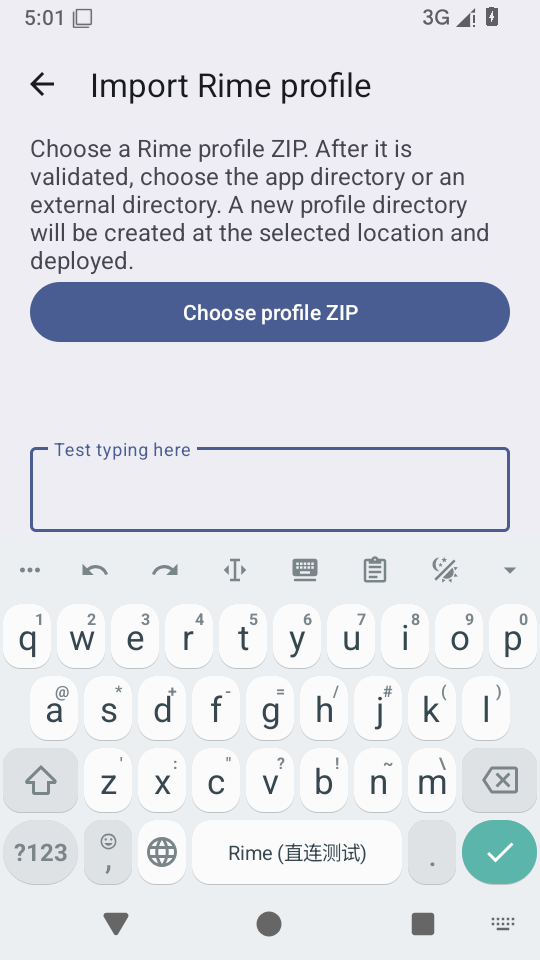
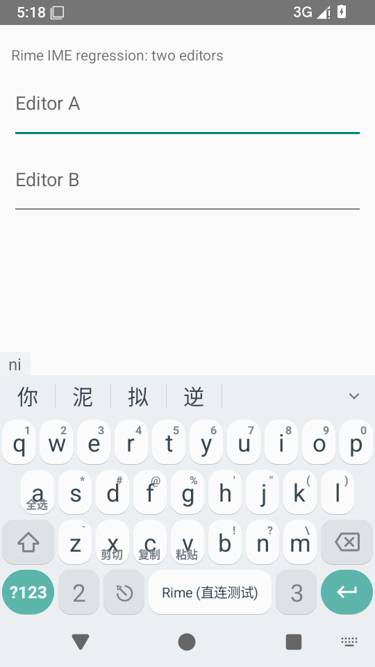
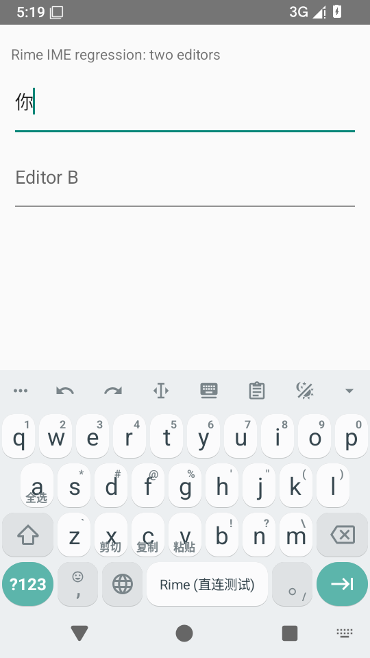

# 同步预算、候选菜单与主题导入续修 · 2026-10-25

运行代码基准为 [`4bb3486c`](https://github.com/SandyYuR/fcitx5-android/commit/4bb3486c2797750164582221abf2bb39d106a959)，分支 `perf/direct-rime-startup-20261024`。后端为 librime 直连，旧 Fcitx 类名和包名仍保留在 Android 前端。

## 分批修复

| 旧编号 | 处理 | 边界 |
| --- | --- | --- |
| N3 | 移动候选后用专用 payload 重绑序号、active；补字体同时变化的保留后缀 | 避免重建未变化的候选文本；有真实 RecyclerView 框架测试 |
| N5 | 方案菜单加滚动容器、方案名换行、保留最小触控高度 | API 35 实际字体布局和滚动末项回归已通过 |
| P2-4 | 请求代号、编辑器、当前视图、候选版本与锚点绑定身份一起核对；点击在 native owner 再核对 | 不将 commit 合并或丢弃；迟到菜单/点击不操作新会话 |
| P2-13 | 移除构建私有 provider 反射、包任务输入篡改与编译后删除 metadata | 保留 AGP 的标准打包产物 |
| C32 | 更新页溢出菜单进入镜像规则管理 | 真实 Activity 导航回归通过 |
| D10 | 图片与相机扫码统一后台串行集片、XZ 解压、JSON 解析和主题保存 | 保留旧版文档格式；取消向上传递；写入异常不重试为另一种格式 |
| A9（仍部分修复） | STOMP、JSON、Base64、密文/明文预算前置，出站计入两层 Base64 和 OkHttp 队列限制，减少全量副本 | OkHttp 4.12 在 onMessage 前仍组装完整 WebSocket 消息；尚未限制该传输层分配，也没有堆峰值实测 |
| P2-15（仍部分修复） | trim、去重、拒绝空/未知 ABI，统一 bundle 与 APK 选择 | 未建立四 ABI 的设备提交门禁 |

另修补两项本轮新增问题：隐藏行箭头复用为普通键/新增键后仍不可见（`d66c9e4a`）；页面销毁时，已取消协程中的 join 可能跳过弹窗关闭（`1db12cec`）。加载弹窗有 12 个 API 23/28 生命周期执行覆盖提前销毁、显示后销毁、正常结束。

按用户指定的默认分支提交 f1234452 已作为 `98f3713c` 同步，并保留 cherry-pick 来源。默认分支后续的 6af8bc0b 不属于本轮同步范围。

## 候选菜单的设备失败与修复

在 `229a344a` x86_64 Debug 的 API 35 AOSP 模拟器中，测试从真实编辑框、真实候选视图进入生产候选动作菜单。菜单正常显示，但 800 ms 后检查发现编辑器窗口失去焦点，[修复前失败记录](./candidate-focus-before.txt)。这是一次实际设备断言失败。

`4bb3486c` 为候选菜单启用不获取焦点的窗口模式；框架测试检查窗口仍接收触摸，设备测试检查编辑器保持焦点、菜单不改变 inputSession，并在改变编辑器类型后关闭旧菜单。测试通过生产菜单入口调用打开，未将它描述为独立长按手势识别验收。

## 最终本地构建

`4bb3486c` 的完整 [897 项应用 JVM 测试](./final-app-jvm-summary.json)、[6 项构建逻辑测试](./build-logic-jvm-summary.json)通过，失败/错误/跳过均为 0；APK 与测试 APK 构建成功。应用测试较 `1c8a7d04` 新增 127 个执行，包含 API 23/28 Robolectric 与 native-owner 排队竞态用例，仍属于 JVM 测试。

[最终 APK 核验](./apk-verification.json)：22 个 dex，16 KiB 对齐，仅 libdirect-rime.so 和 libc++_shared.so，无旧 Fcitx backend 依赖。本轮未新增 ClearURLs 规则资产。

## 已完成的历史检查

- `c80f3ce0`：完整 [863 项 JVM](./c80-jvm-summary.json)，两项 [API 35 设备回归](./c80-device-tests.txt)通过：行操作复用可见性、大字号方案名换行和末项可选择。
- `229a344a`：完整 [881 项 JVM](./229-jvm-summary.json)通过，[镜像入口导航](./229-mirror-device.txt)通过；[APK 核验](./229-apk-verification.json)为 22 个 dex、16 KiB 对齐，仅 direct-rime 与 C++ runtime 原生库。
- `d06f7eab`：[非法 ABI 在配置阶段失败](./invalid-abi-config.txt)是预期结果；[带空格和重复值的 x86_64 AAB 任务图](./bundle-abi-plan.txt)仅配置该 ABI。任务图验证不等于生成并安装 AAB。

## 验证限制

模拟器为 API 35 AOSP x86_64，使用 TCG 和 SwiftShader，没有 KVM。重启时发生过 system_server 的 60 秒 Watchdog 超时，已在该可丢弃测试 VM 调高系统超时并恢复；该系统启动故障不记为输入法崩溃。Debug 下类验证和冷启动的绝对耗时不用于推断手机性能。

此前 `ea6229a4` 的英文模式提示显示断言异常仍待定位；未以本轮菜单测试覆盖它。完整 Direct Boot、四 ABI 装机、FGS 配额、真机语音和 minified ARM64 Release 装机均未在本轮完成。原编辑器关闭期间写入的设备竞态仍只有受控 JVM 覆盖。

## 远端构建

[`4bb3486c` Commit CI 40213813097](https://github.com/SandyYuR/fcitx5-android/actions/runs/40213813097)已成功，完整 JVM 与 ARM64 Release 构建均通过。[下载 ARM64 Release](https://github.com/SandyYuR/fcitx5-android/actions/runs/40213813097/artifacts/12607275703)。未在 ARM64 真机安装该产物。

## 最终设备结果与测试补充

运行 APK 仍为 `4bb3486c`，测试补充提交为 [`e3471045`](https://github.com/SandyYuR/fcitx5-android/commit/e3471045793787a5a4b920e782e1260fae055a72)。两次提交之间仅 AndroidTest 文件变化，应用运行代码没有新增改动；测试 APK 的版本标签仍为 4bb3486c。来源、散列和逐次结果见[provenance.json](./provenance.json)。

[首轮 5 项设备套件](./final-device-first-attempt.txt)中，候选菜单、行操作复用、大字号方案列表、镜像导航 4 项通过；方案菜单测试在 Web 密码框 inputType=225 的“已聚焦且键盘显示”前置条件失败，尚未进入该输入类型的菜单检查。[保持测试不变的单独重跑](./schema-no-touch-repeat.txt)在同处失败。

`e3471045` 在每次程序化改变 inputType 后加入实际点按编辑框，并补上焦点、输入法、可见视图的失败诊断。[修订后的方案菜单测试通过](./schema-touch-device.txt)，完成普通文本、文本密码、Web 密码、数字密码四种类型的点选、Back、外部点击和继续输入。最初两次失败记录保留；没有点按的程序化类型切换显示行为仍待专项定位。

候选菜单的修复后检查通过：显示后等待 800 ms，编辑器窗口仍有焦点，inputSession 不变，菜单窗口不获取焦点且位于 IME 上方；改变编辑器类型后旧菜单关闭。所测入口为生产候选菜单函数，锚点来自真实候选视图。整组设备执行结束时 crash 缓冲区为空。

## 独立宿主的最终触屏输入

安装版本保持 4bb3486c，并将当前输入法设为 Rime 直连版。重新打开可丢弃双编辑框宿主，点按 A 聚焦，依次触屏点击 N、I 和首候选“你”。[宿主实际数据](./touch-host-state.json)为 A=`你`、B 为空，且只有一次发往 A 的 commit。设备保持当前输入法、宿主和键盘。

