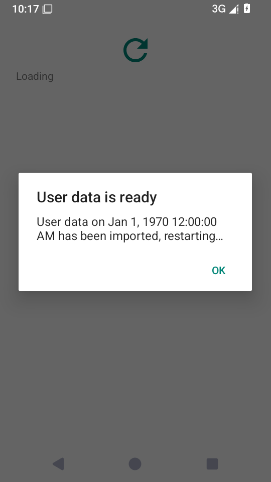

# Android 整包恢复交接 · 2026-10-27

运行代码 [209cca0e](https://github.com/SandyYuR/fcitx5-android/commit/209cca0e7c8e0954d00a6c939e07d05cba160a8f)，测试 [3e09e289](https://github.com/SandyYuR/fcitx5-android/commit/3e09e289cdd4f0a1d52448e519dbc3f15f7999f9)。API35 AOSP x86_64 Debug、无 KVM；发行与CI仍只构建ARM64。[来源、PID及内存映射检查](./provenance.json)

## 实际过程

准备进程PID2526缓存旧偏好，并用真实 Android SQLite 建立 WAL 数据库：先 checkpoint、再提交一行，保持连接打开防止退出 checkpoint。[准备记录](./prepared.json)中 WAL 为4152字节。备份包含同名偏好新值和另一个独立数据库，经过实际 prepareImport、保存/停止引擎及私有恢复请求。

首次交接会杀掉这个 instrumentation 进程；Android 随后的测试清理也可能停止恢复进程。[准备阶段日志](./prepare-interrupted.txt)因此按预期中断，不计为完成的JUnit。宿主等待测试清理结束，再次启动仍保留的同一请求。最终交接时旧主进程是系统为输入法服务启动的普通进程PID2606；恢复进程PID2682实际向它发送SIGKILL，确认死亡后继续恢复。[系统日志节选](./handoff-excerpt.txt)

恢复页实际显示成功。该恢复进程的2864行内存映射中没有 libdirect-rime 或 Fcitx 后端；新普通主进程PID2709随后启动。

## 新进程读回

另起校验进程PID2774：[一项JUnit通过](./verify.txt)，[读回结果](./verified.json)确认：

- SharedPreferences 是导入后的 `imported value`。
- 未被备份替换的数据库仍含 `committed WAL row`。
- 新数据库含 `new database`。
- 恢复请求和目录恢复日志已清除。

本次补齐 Android 进程交接、偏好和WAL功能验收，记录了测试框架自身造成的首次中断与再次启动。未验证真实可拔插卷或物理断电，不把软件模拟器耗时当作手机性能。
