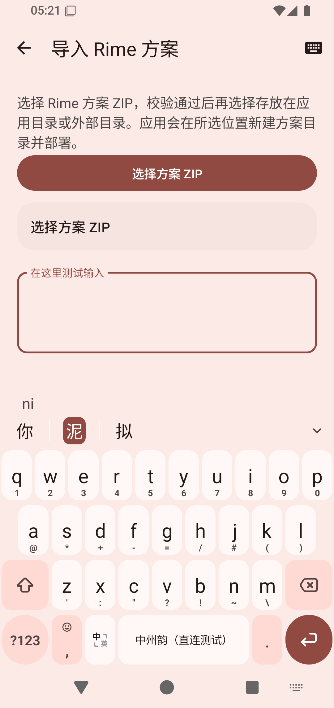
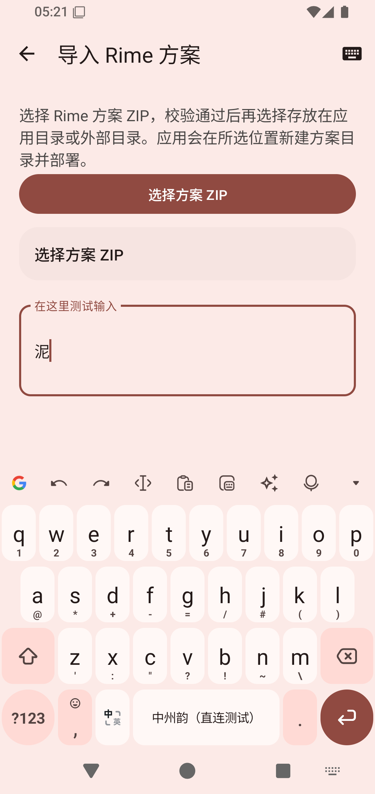

# 输入链路可靠性与局部优化（2026-11-10）

本页记录从 `fx-rime-only@24c4ee07942a67adb48751ff9ae1a24b7fe52ef7` 建立的 `fix/input-rime-reliability-20261110` 分支。目标是先修复已确认的生命周期与异常边界，再补足诊断，最后只实施有直接证据支持的局部优化。下述实测截至应用提交 `c5501024410b6b3dc4a36832bc4d7de88c9880be`，随后终审与分类整理见末节；本页不表示分支已经合并、发布或生成 Release。

## 已实施批次

| 提交 | 结果 |
| --- | --- |
| `7813646cd` 修复服务队列清理 | 服务退出时取消缓冲和拒收的惰性工作，及时释放 ticket；不取消已经取走并运行的工作，也不让失败的分页模式请求重排到关闭队列 |
| `519f5da55` 绑定 tabs 显示目标 | 音节标签动作携带 generation、完整 label/span 变化形成的 `tabsRevision` 与原始索引；排队前后都拒绝过期目标 |
| `e39811d2a` 恢复维护绑定 | 部署、同步等维护在 owner 前取消、操作后取消或抛错时，通过不可取消恢复段只恢复仍属当前代次的编辑器；不复活旧编辑器 |
| `9eb203bae` 加固 JNI 与资源释放 | pending JNI exception 下停止后续非法调用；C++ 包装异常仍释放 iterator、字符串和本地引用；已有 Java 异常不被覆盖，标准 UTF-8 的补充平面文字保持正确 |
| `534b9db02` 补输入诊断 | 增加服务等待／运行／拒收／取消、owner 前容量等待、真实事件批次数、展示替换、结果等待与 Flow 等待；汇总器同时支持 slice 与 counter |
| `1b70bd468` 直接构造发布数组 | tabs 为空时复用空数组，非空 tabs 与候选直接构造最终数组；不改变候选版本、分页、标签回退或点击目标 |
| `182d4df2d` 缓存稳定 status | 只缓存方案 ID、名称和中英文状态；处理 late notification、失败、64 KiB 预算、generation/session/optionsRevision 与全部生命周期失效 |
| `bc29c18a6` 局部刷新候选高亮 | 高亮使用专用 payload，并与角标位移 payload 合并；内容、主题、字体和字号变化仍完整绑定；设备用真实候选导航与点击验证 |
| `cf3de61ec` 修复方案菜单返回 | 复用 InputMethodService 自带的预测返回兼容链，显式消费非焦点菜单的 Back DOWN/UP，只在 UP 取消菜单；连续普通／密码编辑器设备用例保持宿主焦点、键盘、会话和正文 |
| `5861a1f6c` 固定 trace 汇总格式 | trace processor 显式使用 `--no-agent --format csv`，避免新版本在 agent 环境自动改成 Markdown；单元测试检查两条查询 |
| `b924d6e70` 复用输入法展示对象 | 对实际显示的中英文模式、方案 ID／名称和资源显示名建立最后一项缓存；资源语言、方案或模式变化立即失效 |
| `43a4749fd` 复用 UTF-16 缓冲 | 一次完整 JNI snapshot 共用一个 grow-only UTF-16 转换缓冲，并优先转换可能更大的候选／注释；`NewString` 复制完成后才复用 |
| `f2b1bbf5a` 补条件项探针 | replay 输出 ART 分配和 `InputMethodEntry` 身份变化；加入长字符串、129 条 algebra 规则、真实 Service 长按节奏和极限 burst 夹具 |
| `510208b95` 稳定队列夹具 | 在设置 600 字正文引起的 Android restartInput 完成后才开始压力负载，守恒收紧为 41＝41 与 200＝200，不把旧 generation 拒键混入队列结论 |
| `c55010244` 适配紧凑 ATD | 菜单外点击从编辑器中心、左右边、上边、下边中选择宿主窗口内的真实外部点，兼容本机 1080 宽和 CI 320×640 全宽菜单 |

没有恢复 Fcitx 原生后端，没有改变输入队列容量、合并退格或跳过 release，也没有修改发行 SDK 锁、方案数据和依赖版本。

## 本机与设备验证

| 检查 | 本轮结果与边界 |
| --- | --- |
| 最终相关 JVM | 12 个测试类、126 项；failure/error/skipped 均为 0 |
| native Fake API | status 命中、context/tabs 内通知、一次和连续 late notification、失败恢复、过期代次、维护、session/generation、end/stop/deploy 与 64 KiB 边界均走过 |
| Windows host `engine-contract` | status 缓存等前置断言通过；完整进程最后仍在 `testGeneratedConfigInvalidation` 真实创建符号链接时报“客户端没有所需的特权”，因此不能报告整套通过 |
| host `input-statistics-contract` | 5 组通过 |
| ARM64 Debug | 构建成功；APK SHA-256 `14537fd73e83e318f449ba3f63b3ff2bfdd5dd2261bedb8629190a94a0e612d8` |
| APK／链接门禁 | 只含 `libdirect-rime.so`、`libquickjs.so`、`libc++_shared.so`；七个固定静态引擎库全部匹配，未发现 Fcitx C++ 符号，16 KiB 对齐通过 |
| `rime` 模拟器原生 smoke | `emulator-5574` 上隔离 `.lab` / `.lab.test` 使用 `install -r -t`，Direct Rime、InputConnection、Lua/OpenCC 学习／同步／重启共 6 项通过 |
| 候选设备回归 | Debug 包保留数据覆盖安装；真实软键输入 `ni` 后把高亮从“你”移到“泥”，点击“泥”只提交一次；另 3 项角标布局测试通过 |
| 补充相关 JVM | 6 个测试类、44 项；failure/error/skipped 均为 0，覆盖展示对象缓存、输入 gate、事件队列、服务工作队列、诊断与退格边界 |
| 最终 x86_64 普通 Debug | 固定发行 SDK 构建成功；APK SHA-256 `5346a5d246a0f47b67370a70d021b4a32631d0e97fb5d2ff8af640d7b2dc2058` |
| 最终 x86_64 APK／链接门禁 | 三个允许的 `.so`、七个固定静态库、无 Fcitx C++ 符号及 16 KiB 对齐全部通过 |
| 补充设备回归 | 固定发行 SDK 的普通 replay、12 KiB 长注释 replay、Service 长按／burst、四类普通／密码编辑器方案菜单共 4 项连续通过 |

设备测试只操作既有 `rime` AVD，没有新建 AVD、清数据、卸载、换签名或覆盖 Release。测试前后核对并恢复屏幕超时、硬键盘显示和默认输入法；临时测试 profile 由 instrumentation 恢复并删除。

## status 缓存观测

在提交 `182d4df2d` 的 x86_64 `.lab` 上，用 app trace 包围同一组 6 项 smoke：

| trace section | 次数 |
| --- | ---: |
| `rime.direct.snapshot` | 74 |
| `rime.direct.read_status` | 63 |
| `rime.direct.get_status` | 12 |

Ready 快照仍进入 `read_status` 阶段并复制三个字段；只有 miss 与稳定性复读进入真实 `get_status`。其余 snapshot 为门控分支，不进入 status 阶段。该计数证明本负载下重复 API 读取减少，**不是**通用命中率、端到端延迟或耗电结论；不同方案的 option 通知频率会改变结果。原始 trace 保存在本地验证目录，站点只保留其字节数、SHA-256 与计数摘要。

## 条件项补测与后续优化

### `InputMethodEntry` 分配

同一 bundled smoke replay 预热 20 词后测量 100 词／300 键。优化前后各运行三次；ART 计数在测量区间前后读取，送键延迟仍受模拟器调度影响，不据此宣称延迟改善。

| 指标 | 优化前 | 优化后 |
| --- | ---: | ---: |
| 展示对象身份变化 | 每轮 300 | 每轮 0 |
| ART 分配对象 | 17,652–17,754 | 16,360–16,418 |
| ART 分配字节 | 1,015,808 | 950,272–983,040 |

对象数减少约 7.3%–7.9%，字节减少 32–64 KiB。缓存只比较可见字段；西文态忽略后台方案变化，回到中文态仍按新方案重建，资源显示名变化也会重建。

### algebra 分阶段

从 `zhongzhou@b5561910d9eba97a273e09e7996535679b730032` 建立独立 worktree，开发 SDK 源树为 `9aa3037ca0fcee8b1cc860fbdbd1ff06ea5ea117`。临时测量切片把 translator 的建图、`ParseAlgebraReverseMapping` 和输出拆开；开发 SDK 仅显式接入 Debug，随后切回固定发行 SDK，发行锁始终未改。

| fixture（120 个样本） | graph p50 / p95 | algebra p50 / p95 | output p50 / p95 | algebra 阶段占比 |
| --- | ---: | ---: | ---: | ---: |
| bundled smoke，无 algebra | 2.165 / 2.994 µs | 1.322 / 1.893 µs | 2.034 / 2.844 µs | 30.4% |
| 固定 129 条重规则 | 2.539 / 5.049 µs | 18.873 / 41.859 µs | 3.710 / 7.031 µs | 74.86% |

重规则 fixture 的 algebra p99 为 107.670 µs，但 p95 仍只有 0.042 ms；普通 fixture 的整个 `rime.direct.read_input_tabs` 既有 trace p95 为 0.013682 ms。按规则内容做安全缓存仍需处理原地修改、替换与重排，绝对收益不足以支持把该状态引入发行引擎，本轮停止在测量，不修改 SDK 来源或发行锁。

随后直接使用本机长期 `rime-wanxiang` profile 补测已部署的真实方案。测试从原来的“万象拼音”临时切到已启用的“万象九键”，输入通过 ADB 注入 Android 触摸事件，经过屏幕软键入口；每段组合通过退格清除，不上屏，结束后恢复“万象拼音”。开发 SDK 仍只用于本次 Debug 测量，随后覆盖回固定发行 SDK 的普通 APK。测量 APK 的 SHA-256 为 `8749732af32b06808aa1f9e310f7ef95c7e740c9a38cbbdbd382bd7894159ac8`。

下表样本单位是 translator 调用，同一按键可能产生多次调用。两个 script 样本集的原始编码长度均为 1–9 字节，table 为 3–8 字节；分位数按排序后的 nearest-rank 计算。它们来自已启动会话，未覆盖冷启动、超过 9 字节的编码、额外 CPU／内存压力或缓存实现的 A/B。

| 真实方案／translator | 样本 | graph p50 / p95 | algebra p50 / p95 / p99 | output p50 / p95 | algebra 阶段占比 |
| --- | ---: | ---: | ---: | ---: | ---: |
| 万象拼音／script | 234 | 67.328 / 238.723 µs | 22.573 / 49.182 / 119.405 µs | 12.943 / 103.983 µs | 17.49% |
| 万象拼音／table | 28 | 4.295 / 6.547 µs | 14.208 / 25.321 / 25.898 µs | 7.379 / 16.226 µs | 55.05% |
| 万象九键／script | 234 | 31.875 / 177.748 µs | 12.811 / 26.965 / 66.830 µs | 23.286 / 58.235 µs | 15.26% |

本轮真实方案样本的 algebra p95 最高为 0.049 ms，万象九键为 0.027 ms；单次最大值分别为 0.373 ms 与 0.443 ms。该范围内没有取得足以支持引入规则内容缓存及修改／替换／重排失效状态的收益证据，因此本轮继续不实施缓存；这不代表已经排除其他设备或负载上的瓶颈。

### JNI UTF-16 临时缓冲

64 KiB heapprofd trace 成功记录 11,301 个 unwind 样本；`Native_key` 路径的加权样本仍混合引擎内部工作，不能直接当 JNI 分配。于是 `INPUT_DIAGNOSTICS` 临时精确记录每个 snapshot 的字符串数、UTF-8 字节和 UTF-16 buffer 扩容，再移除逐 snapshot 日志，只保留低开销 `rime.direct.jni_snapshot` slice。

普通 fixture 的 365 个 snapshot 共 361 次扩容；合成的 12 KiB 长注释 fixture 在相同 365 个 snapshot 中从 1,081 次降到 361 次，减少 720 次（66.6%），典型长 snapshot 从 4 次降到 1 次。普通 fixture 仍为 361 次，没有增加扩容。长串 replay 继续正确提交 100 个“你”，没有重复 commit。

### Service 队列压力

最终夹具 trace 为 11,860,600 字节，SHA-256 `ffb261e3c6af16beba7436d0febded7752190b796e6de246026b157f95a0ea33`。定时夹具使用当前 300 ms 长按延迟和 50 ms repeat；极限 burst 只作上界。

| 负载 | 守恒 | service waiting | service wait p50 / p95 | result wait p50 / p95 | 结果批次峰值 |
| --- | --- | ---: | ---: | ---: | ---: |
| 300/50 ms repeat 夹具 | 41 入队＝41 native＝41 转发＝41 删除 | 1 | 0.408 / 0.860 ms | 0.666 / 55.779 ms | 1 |
| 200 键 burst | 200 入队＝200 native＝200 转发＝200 删除 | 193 | 113.863 / 218.450 ms | 25.032 / 68.161 ms | 19 |

两段负载在 slice 结束时 `waiting/running` 都已归零，sequence gap 为 0；用户节奏的 `pending_batches` 同步归零，burst 结束时剩 19 个结果批次并在 10.091 ms 后归零。抬手后 300 ms 正文长度不再变化。用户节奏没有持续积压，因此不改容量、不合并退格、不丢输入；burst 的积压和约 234 ms native 排空时间保留为上界证据。

上表定时夹具直接向生产 Service 队列投递。补测又在“万象九键”真实会话中，对屏幕上可见的退格键注入一次 8 秒 Android 触摸按住；当时 418,080,812 字节万象模型已由进程映射。本段测的是无组合时删除已有的 600 个拉丁字母 `x`，未额外制造 CPU／内存压力，模型映射本身不证明模型计算处于高负载。

编辑器正文从 600 个字符变为 449 个字符，共删除 151 次。两次后续 UI 抓取都得到 449：第一次在触摸命令返回、等待 300 ms 后发起，第二次在第一次抓取完成后再等待 1.2 s 发起。`uiautomator dump` 自身也耗时，因此原文件名中的 `300ms`／`1500ms` 不能当作精确采样时刻。停止行为另从 trace 核对：实际 `ACTION_UP` 后剩余 5,966.768 ms 记录内，没有新的 native `process_key` 或 `InputConnection#sendKeyEvent`。

| 真实软键 8 秒长按 | 结果 |
| --- | ---: |
| Service 任务／native `process_key`／正文删除 | 151 / 151 / 151 |
| `InputConnection#sendKeyEvent`（DOWN／UP 合计） | 302 |
| sequence gap | 0 |
| `service waiting`／`running`／结果批次峰值 | 1 / 1 / 1 |
| service wait p50 / p95 / p99 / max | 0.217 / 0.888 / 1.064 / 1.711 ms |
| native `process_key` p50 / p95 / p99 / max | 0.072 / 0.229 / 0.652 / 0.728 ms |
| result wait p50 / p95 / p99 / max | 0.487 / 1.821 / 3.407 / 122.045 ms |

result/Flow 各有一个约 122 ms 的尾点，期间 `pending_batches` 峰值仍为 1。复核还发现跨线程时序异常：151 组等待计数中，48 组开始时间戳早于入队时间戳，最大倒序 0.206 ms；151 个 `service.wait_ns` 样本中有 46 个为经 `coerceAtLeast(0)` 处理后的零值。末条 `waiting` 为 1，`running` 与 `pending_batches` 为 0，不能把这一 trace 写成“等待计数已归零”，也不能用它证明微秒级调度收益。该异常的具体来源尚未定位。

停止决定依据本段任务完成数、native 次数、编辑器删除数一致，以及触摸抬起后的送键停止证据；等待／结果批次也未出现持续增长。这些观测不支持本轮改变队列容量或重复键策略，额外高负载仍属未验证范围。原始真实触摸 trace 为 5,276,647 字节，SHA-256 `95e865454921d186f9e1f614ba6b965314ef2c31f657ec9bd2e9756fff7e5c27`；trace 导入未报告错误或丢失事件。

## 候选高亮设备画面

高亮导航后，只有实际第二候选“泥”使用 active 背景；候选正文、角标和键盘字体仍由完整配置生成：

点击该候选后，测试编辑器只出现一个“泥”，候选栏随组合结束关闭：

## 远端门禁

分支每个批次推送后都等待 PR CI 的 JVM 与 Debug APK 两个作业完成；下列运行均为 `Success`：

- [42747600169](https://github.com/SandyYuR/fcitx5-android/actions/runs/42747600169) — 服务队列清理
- [42750191473](https://github.com/SandyYuR/fcitx5-android/actions/runs/42750191473) — tabs 目标
- [42751417997](https://github.com/SandyYuR/fcitx5-android/actions/runs/42751417997) — 维护取消恢复
- [42753434299](https://github.com/SandyYuR/fcitx5-android/actions/runs/42753434299) — JNI 与资源异常
- [42755586201](https://github.com/SandyYuR/fcitx5-android/actions/runs/42755586201) — 诊断指标
- [42756763154](https://github.com/SandyYuR/fcitx5-android/actions/runs/42756763154) — 数组直接构造
- [42758751825](https://github.com/SandyYuR/fcitx5-android/actions/runs/42758751825) — status 缓存
- [42762060204](https://github.com/SandyYuR/fcitx5-android/actions/runs/42762060204) — 候选高亮 payload
- [42782814172](https://github.com/SandyYuR/fcitx5-android/actions/runs/42782814172) — 最终 `c55010244` 的 PR CI，JVM 与 Debug APK 全部成功

用户随后明确授权启用 `Direct Rime CI`。工作流 `386451381` 已从 `disabled_manually` 改为 `active`：首次全量运行 [42766009498](https://github.com/SandyYuR/fcitx5-android/actions/runs/42766009498) 的 APK、prototype 与 engine smoke 通过，设备作业稳定复现方案菜单 Back 后宿主焦点失败；本地同样复现后完成 `cf3de61ec` 修复。第二次运行 `42780791796` 证明产品行为已通过，但暴露 320×640 ATD 上测试外部坐标仍落在全宽菜单内；`c55010244` 改为从宿主窗口计算真实外部点。最终全量运行 [42782853446](https://github.com/SandyYuR/fcitx5-android/actions/runs/42782853446) 的 prototype、engine smoke、ARM64 APK 与完整前端设备 41 项全部成功。

## 条件项结论

- 已实施：`InputMethodEntry` 最后一项复用与 JNI snapshot 范围 UTF-16 buffer 复用；两项都有优化前后同 workload 分配数据。
- 本轮不实施：algebra 缓存。129 条固定重规则的 p95 为 0.042 ms；已测真实万象拼音和万象九键的最高 p95 为 0.049 ms，尚无足够收益证据支持引入新的失效状态。
- 本轮不实施：队列容量、背压和重复键调度。直接入队夹具不持续积压；补充的万象九键 8 秒软键触摸产生 151 次处理和删除，抬手后约 6 秒没有新增送键。跨线程时间戳异常与额外高负载未覆盖的限制一并保留。

因此本轮的结论是“补齐了缺失数据，实施了两项有直接分配证据的优化，并保留两项有数据支持的停止决定”；没有声称检出稳定的端到端延迟或耗电改善。

## 证据附件

- [验证摘要 JSON](../audit/input-reliability-20261110/summary.json)
- [候选高亮截图](../audit/input-reliability-20261110/candidate-highlight.png)
- [候选提交截图](../audit/input-reliability-20261110/candidate-commit.png)

仓库外的原始资料位于 `.verify/2026-11-10-input-reliability/`，包括 native 异常探针、诊断 APK、原始 app trace 及其摘要。该目录不是 Git 仓库内容；上面的 JSON 记录纳入站点附件的摘要与未纳入原始文件的哈希。

## 最终审阅与分类整理

本节追加终审发现与提交归并结果。上文旧 SHA、旧测试和性能数字继续对应原来的执行记录；本节的修复与验证另行登记。

### 终审修复

| 问题 | 修复与验证 |
| --- | --- |
| 候选迭代器 API 自身抛错后，作用域清理可能二次释放已失效指针 | 锁定 SDK 会先删除旧 text/comment 再分配新值，因此仅在 `candidate_list_next` 正常返回后允许 `candidate_list_end`。第一步／后续步 API 异常回归在修复前失败、修复后通过；包装层复制失败仍恰好调用一次 `end` |
| 关闭诊断后仍为每个 Service 任务登记空的完成回调 | 仅在确有 `ServiceTask` 时登记诊断回调；保留原有 ticket 结算和队列关闭处理 |
| 队列压测没有恢复硬键盘下显示输入法的系统设置 | 保存原值并在 finally 恢复；设备测试以 0 为初值，压测结束确认恢复为 0，再由验证脚本恢复用户原值 1 |
| 现行契约缺少已实现边界的说明 | 补齐 tabs 目标传递、维护取消恢复、输入法展示对象缓存与 native 资源所有权约束 |

迭代器修复防止包装层对部分失效指针二次释放，不声称已经回收 SDK API 内部异常时的所有部分分配；引擎内部的完整异常安全仍需独立 SDK 工作。发行锁和 SDK 版本没有改变。

### 分类后的提交

代码以原基线 `24c4ee07942a67adb48751ff9ae1a24b7fe52ef7` 保持线性历史，将原 15 条提交及本轮 3 条修复重组为 6 条：

| 新提交 | 分类 | 纳入原提交数 |
| --- | --- | ---: |
| `f1e79265f` | 服务任务清理与维护绑定恢复 | 2 |
| `748eeec67` | 音节目标、候选数组与局部刷新 | 3 |
| `bdd989df0` | 原生资源边界、状态缓存与 UTF-16 缓冲 | 4 |
| `68d58f983` | 方案菜单返回与编辑器焦点 | 2 |
| `e703e0110` | 输入法展示对象复用 | 1 |
| `ced42aeac` | 输入诊断、回放与可恢复的压力回归 | 6 |

修复后原末尾 `6db6615751b86adeeb10a7dcf3ef6f900a709f72` 与整理后末尾 `ced42aeac3c12e7b5582bda4960c56894f01cbc0` 的 tree 均为 `5d2335e38a683a587747fbdfbfff97161b9b0332`；18 条原提交全部且仅归入一组。

文档以 `b61af0025df5abd6f92b5d59025176579b9d131a` 为基线，将原 3 条提交及本轮契约补充按文件拆为 `b6798ebe7`（现行输入契约）和 `e9551f7e7`（历史实测与证据）。整理前的 `68c72c4e9497927da03fcf998a7dd4aaf4b93241` 与这两条整理后的 tree 同为 `03949eddb8dc6251cdb78d725462816b4421064f`。本节和映射附件作为第三条终审记录追加，属于新增记录，不混入纯归并的内容一致性断言。

完整旧新 SHA、每组原提交、文件归属和恢复依据见[分类整理映射](../audit/input-reliability-20261110/history-rewrite.json)。两次纯整理均在临时索引内完成，校验内容树相等后才更新分支；恢复 bundle 保存在工作区 `.verify/2026-11-10-input-final-review/`，并已通过 `git bundle verify`。推送分别绑定原远端完整 SHA 使用 `--force-with-lease`。核对的 65 个远端标签（含剥离指向共 72 条记录）保持不变，未创建归档标签。

### 终审验证与版本影响

- 相关 JVM：8 个测试类、61 项，失败／错误／跳过均为 0；执行时的代码 tree 与整理后相同。
- 原生故障注入：API 异常后的不安全 `end` 为 0 次，包装复制失败后的 `end` 为 1 次；JNI pending exception、资源释放与补充平面 Unicode 检查通过。输入统计原生契约及 trace 汇总器测试通过。
- 完整 Windows host 契约仍在实际 `create_symlink` 时因权限不足退出，不计作整套通过；新提交的 Linux 原生门禁由下述 Direct Rime CI 执行。
- 整理后 `ced42aeac` 的普通 x86_64 Debug 与测试 APK 构建成功；APK、静态链接及 16 KiB 对齐门禁通过，签名与原安装一致。Debug APK SHA-256 为 `73e8e2ff3cb6b83b25b38ba2eae37869fdfb338d3b2671aa23d97eb4f84fe404`。
- 同一台 `rime` 的候选／编辑器契约与 Service 队列两项设备回归通过，包含真实候选迭代、Unicode、过期编辑器、单次提交和 41／200 次退格守恒。`rime.conf` 与目录注册文件逐字节恢复，偏好仅进程号变化；默认输入法、布局和万象拼音方案保持原值。

新提交的 [PR CI 42802957691](https://github.com/SandyYuR/fcitx5-android/actions/runs/42802957691) 两个作业与 [Direct Rime CI 42803182615](https://github.com/SandyYuR/fcitx5-android/actions/runs/42803182615) 四个作业均成功。后者包括完整 Linux 原生安全契约、引擎 smoke、ARM64 APK 与前端设备回归；两次运行的来源均为 `ced42aeac3c12e7b5582bda4960c56894f01cbc0`，完成状态记录在映射附件中。

`git describe` 的末尾距离由原来的 15、修复后的 18 缩短为 6，最近标签保持不变。当前更新器提取的首个版本段仍相同，比较数字没有变化；ARM64／x86_64 的 versionCode 仍为 112／114。本轮没有递增发行版本或生成 Release。
