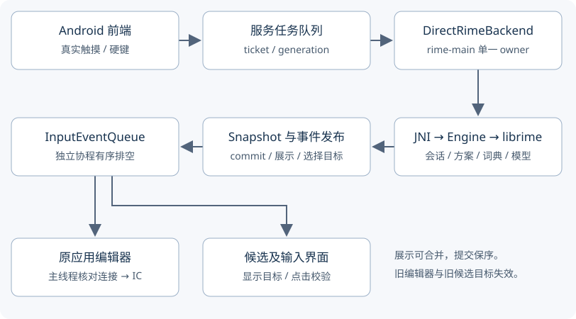

# Rime 直连架构与职责边界

主应用的输入路径是 Android 前端 → Kotlin 单一 owner → JNI → librime。`FcitxAPI`、`FcitxEvent` 和服务类名保留前端协议兼容用途，不表示仍有原生 Fcitx 引擎运行。本页说明协作方式；具体失效条件和验收入口以[正确性契约](./correctness-contracts.md)为准。

本文依据默认分支 `0380d70f` 的引擎与后端实现。候选界面的后续性能改动不改变这里的 owner、事件顺序或维护协议；日期实测不能自动成为所有设备的性能保证。

## 一次按键如何到达编辑器

`InputKeyGate` 的 ticket 在排队之前取得。只在 native 调用前检查当前编辑器，无法分辨“先进入队列的旧按键”与“新编辑器的按键”；ticket、generation 和候选版本共同解决这个问题。维护、停止或新编辑器会使旧请求失效，不能为提高吞吐绕过校验。

JNI 返回的 `Snapshot` 同时包含本次 commit 和对应展示。提交先成为有序事件，再由原输入连接交付；刷新界面不能重放旧 commit，也不能提前拿候选文字替代引擎真正提交。

## 谁拥有状态

| 组件 | 状态与职责 | 不能转移的边界 |
| --- | --- | --- |
| 服务队列 / `InputKeyGate` | 按键准入、ticket、编辑器 generation | 不在 owner 内等待 UI 消费，不允许旧编辑器补交输入 |
| `DirectRimeBackend` | native 会话协调、当前快照、候选版本、维护状态与前端协议实现 | 统一决定发布与失效，不能拆成各自启动协程的多个输入管道 |
| `EngineLifecycleController` | start/stop 去重、初始化/停止竞态与状态通知 | 停止完成前不能打开同一批数据库或开始下一次初始化 |
| native `Engine` | librime session、revision、action 白名单、稳定 status 缓存、tabs 版本 | 全部经 `rime-main`，维护和过期代次不得重新激活旧会话 |
| JNI 桥 | 字符编码、引用与异常边界、不可变展示值复用 | 不共享可变 Rime 指针，不缓存或再次发送旧提交 |
| `InputEventQueue` | 有序副作用与相邻展示合并 | commit、转发键和生命周期事件不跨界合并；容量等待发生在进入 owner 前 |
| `CandidatePageReader` 与展示组件 | 分批读取展开候选、绑定 holder、点击校验 | 展示相同也需更新目标，旧分页不能套用最新候选版本 |
| 配置、资源更新与事务工具 | 准备文件、校验目标、安装与回滚 | 不删除数据库或 LOCK 绕过占用，不在重启前丢失失败恢复状态 |

owner 上的同步状态与跨线程可读的缓存并不是两套引擎。`snapshot`、候选版本和几个前端缓存按既有 volatile/原子边界发布；改成共享可变“全局状态袋”会掩盖状态归属。

事件排空不占用 native owner。否则 UI 在接收候选事件时请求更多候选，可能与等待 UI 的 owner 形成互等。排空协程、native runtime 和可重复 start/stop 的生命周期也要区分，不能在一次 stop 时直接取消所有任务并丢掉已接受的提交。

## 会话、候选与维护

同应用、普通可学习编辑器可以复用仍有效的 native session，并清空上一段 composition。跨应用、密码、禁止学习或 Direct Boot 的边界必须隔离会话；方案 reset 与保存开关由 Rime 决定，前端不回放上一编辑器的临时状态。

候选显示文字和选择目标是不同信息。`CandidateSelectionTarget` 带 generation、候选版本和原始序号；音节动作还依赖 `tabsRevision`。即使两段显示文字相同，旧目标也未必仍有效。优化中不能通过修改已发布对象的目标，把旧候选重新标成当前候选。

维护由统一的 `maintain` 入口执行：

1. 串行取得维护锁、阻止新键、推进 generation 并保存可恢复的绑定信息。
2. 进入 owner，撤销旧绑定、更新维护展示，执行同步、部署、目录切换或文件事务。
3. 必要时 finalize/initialize，刷新方案与绑定；异常时走受保护的恢复流程。
4. 退出维护，按实际引擎状态恢复按键准入。

重部署不能只销毁 session：Lua `require()` 缓存和组件持有的配置、数据库可能仍在运行时中。文件更新的暂存准备可以提前完成，安装/重开数据库的关键部分仍须受到维护协议保护。详细文件事务见[恢复事务](./user-data-restore.md)及[引擎更新](../engine-update.md)。

## 缓存与可观测性

native 只缓存稳定的 `schema_id`、`schema_name`、`ascii_mode`，键包含 generation、session 和 `optionsRevision`，读取前后复查版本。`read_status` span 每次出现，不等于每次都实际调用 `get_status`；真正的调用另有 `rime.direct.get_status` 标记。

Ready 快照仍读取动态 context 和音节信息。不能仅凭 preedit 文字相同缓存 `get_input_tabs`，因为相同标签可以对应不同跨度，音节动作的失效规则必须继续成立。JNI 展示复用只共享不可变值，每次仍返回新的 revision，旧 commit 清空，并保持现有预算和维护失效规则。

生产构建保留 `Engine` 的 `rime.direct.*` ATrace 标记，可按需采集；细粒度 CPU、缺页、I/O 与 16 槽计时受 `INPUT_DIAGNOSTICS` 控制，JNI 打包细分标记也属于诊断范围。因此“生产零 trace、零开销”不准确，也不能承诺普通用户日志包含完整逐键诊断。

性能分开观察事件注入、IME 分发、owner 排队、Rime 调用、快照、IC 和界面绘制。CPU 与 wall time 分开记录；有 trace 的归因样本不并入无 trace 对照表。近期例子见[首键与点选调查](../perf/wanxiang-2026-11-08/supplement-2026-11-11/investigation-2026-11-11/index.md)。

## 修改与验证入口

- 按键、会话、候选与分页：`InputKeyGateTest`、`InputEventQueueTest`、`CandidateSelectionQueueTest`、候选目标与分页测试；行为变化补真实 librime / Android 前端回归。
- native 门控、revision 与资源安全：`engine_test.cpp`、ASan/UBSan 主机回归、SDK/原生链接与 APK 门禁。
- JNI 仍需设备侧验证；`engine.cpp` 的 sanitizer 通过不能直接代表 `bridge.cpp` 或真实 JVM 的 JNI 路径已被完整覆盖。
- 界面性能修改同时检查注释、字体、字号、候选角标、长文本溢出、触摸取消及选择目标；构建成功不能代替这些行为验收。

结构整理的建议和顺序见[2026-11-12 后端审查核对](../history/direct-rime-backend-review-2026-11-12.md)。后续提取组件应减少耦合，并保持以上线程与事务边界；文件变短本身不是性能结果。
