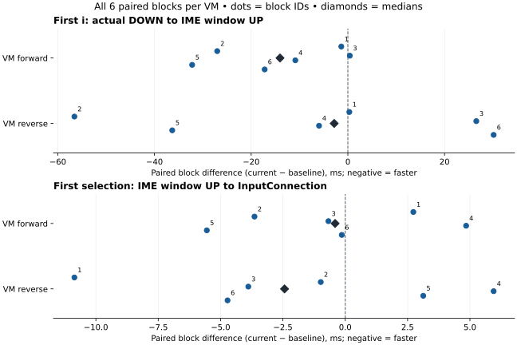

# 当前默认版输入链路复核与两项前端改动（2026-11-13）

**本轮有冷态改善迹象，尚未证明稳定提速；两项改动留在独立审阅分支，未自动加入 PR #32 或默认分支。** 两台 VM 的首次完整 i 配对差中位数为 −14.036ms／−2.827ms，首次点选为 −0.407ms／−2.435ms；首次 i 分别五快一慢、三快三慢，首次点选均四快两慢。没有触发跨 VM 一致的冷态回退规则，但没有达到事前稳定收益门槛。

已经落地的是两项具体变化：普通候选绑定不再提前拆分字形簇；分页候选按组件能力只分发一次，移除依赖 500ms 猜测模式的逻辑。默认版与试验版合计 **174 项目标 JVM**、试验版 **56 项设备功能检查**均实际通过。正式采样 **48 个新进程、288 次正确选词**，另有单独 trace VM 的两个进程、12 次选词，不混入正式分布。

## 真实基线与来源

本轮没有沿用旧 PR #32 代表最新默认版。实际默认分支 `88a664d4` 已加入外置引擎管理；在任何构建或采样前，已把两项改动移到它上面。两版均保留新增引擎管理，**均不叠加 PR #32 的字体缓存修复**。不能用本轮覆盖此前字体修复的风险记录。

| 对象 | 精确提交或记录 |
| --- | --- |
| baseline：实际默认版 | 88a664d46ba82712d5457d86c037629c478b042c |
| current：默认版＋两项改动 | f02bbaec1c2820545382dab82b3e007e9f2735fe |
| 按需拆分字形簇 | cc8c26015e6d67d3d5cfc7ba880db8205891dde7 |
| 分页按能力分发 | f02bbaec1c2820545382dab82b3e007e9f2735fe |
| 原构建驱动 | b070c2b7b0d9a3ca446e444204408f11717dbe2f |
| 恢复采样驱动 | 6b4cf6e8a9ae2043081f227bf8a85962c6cfe07e |
| 构建与功能验证 | [43408540911](https://github.com/SandyYuR/fcitx5-android/actions/runs/43408540911) |
| 复用原 APK 完成正式与 trace 采样 | [43410655925](https://github.com/SandyYuR/fcitx5-android/actions/runs/43410655925) |

生产变化仅涉及五份 Kotlin 文件，见[范围核验](./pipeline-scope.json)和[两个产品提交](./product-commits.mbox.txt)。独立驱动的两个测试工具提交不属于拟采用的产品改动。[审阅分支](https://github.com/SandyYuR/fcitx5-android/tree/perf/input-pipeline-20261113)保留完整线性历史，PR #32 代码仍为 `2e86e2ec`。

第一轮构建和 56 项设备检查成功后，计时任务在启动模拟器前失败：默认浅检出缺少 `f02bbaec` 祖先提交，严格源码哈希校验无法读取它。首次正式／trace 进程均为 **零**。恢复驱动补齐检出历史，并钉死原构建、功能结果和所有 APK 哈希，**不重建 APK、不重复功能测试、不改变源码、种子、协议或判定门槛**。失败现场完整保存在[启动记录](./initial-launch-records.zip)及[运行身份](./run.json)；没有用重跑替换不利样本。

## 整体审阅和实际修改

| 链路 | 代码事实与处理 |
| --- | --- |
| 首键准入、会话与生命周期 | 已有入队前 ticket、同应用非敏感会话复用、维护和停止门控；继续保留，不靠丢 release 或放宽绑定换取计时 |
| owner 与展示队列 | 提交／转发保序，仅合并相邻展示；候选绑定显示代次。保留这些边界，不把 UI 放到原生 owner |
| 原生快照和 JNI | 已有状态 revision 缓存和有容量限制的不可变展示共享；Lua 与音节标签可独立变化，不用“编码没变”跳过实际处理 |
| 新增引擎管理 | 文件校验、探测和库加载在启动／切换阶段；正常按键使用选定的 Engine 实例，未发现每键重新加载库 |
| 候选绑定 | 原先每次绑定立即执行 BreakIterator，即使之后只点整词。改为第一次真正上滑打开单字窗时执行，普通绑定／点击不再预做拆分 |
| 候选广播 | 原先分页先广播兼容列表，再广播完整页；横条借 500ms 时间窗避重。改为分页组件接完整页，其他组件接一份共享兼容列表，每个组件只收到一种表示 |
| 冷态绘制 | 本轮 trace 再次看到主线程等待 RenderThread；需要与正式分布分开解释，不能将它笼统归为 librime 变慢 |

`BaseInputView` 继续使用绑定时显示的 String 和原 `BreakIterator(Locale.ROOT)`，不引入每次绑定的 Lazy 或新缓存；弹窗打开后的移动复用其字符列表。字形簇仍正确处理组合字符 `é` 和补充平面汉字 `𠀀`。下滑菜单、整词选择、取消和重绑路径保留。

`PagedCandidateReceiver` 显式声明分页能力。`InputView` 不再先发合成列表，`InputBroadcaster` 保持候选数组和 selectionTarget 身份，横向组件不再吞掉刚收到分页之后的真实列表。分页去重、字体失效、展开代次和候选目标校验均保留。

**500ms 是旧代码抑制某些真实列表的时间窗，不是每次输入的延迟，删除它不代表提速 500ms。** 这项模式切换正确性与少做字形簇拆分可以分别说明，不能直接换算成稳定的端到端毫秒收益。

## 构建、正确性和依赖

两版使用相同 CI Debug 签名、SDK 锁、性能探针和中立编辑器。baseline 实际执行 85 项 JVM，current 执行 89 项；新增四项测试使用真实广播器和依赖容器，验证唯一分发、共享兼容列表、清空、模式顺序及相同显示内容下的新候选代次。失败／错误／跳过全零，见[JVM 与 APK 核验](./jvm-and-apk-validation.json)。本地测试工具另有 [111 项 Python 检查](./tool-tests-final.txt)，不计作 Android 功能测试。

试验版单独设备 VM 执行 [56 项声明用例](./expected-device-cases.json)，包括输入队列、立即输入和点选、候选动作、方案／密码框、设置和新增引擎管理页面，以及候选布局与取消手势。新增用例通过真实 InputView 验证分页→列表→分页立即生效，并在实际长按上滑后检查字形簇、取消不提交、解绑清理。测试使用仓库烟测配置；原始万象夹具用于后面的计时。[设备原件](./quality.zip)及[逐项核验](./device-quality-validation.json)均保留。

四个产品／测试 APK 哈希、签名和宿主身份见[产物清单](./products.json)；不把 APK、模型、夹具或密钥提交 Git。[构建记录](./build-records.zip)含实际 JUnit XML、构建日志及原生链接审计，另有[逐文件摘要](./build-records-manifest.json)。两版仅含 `libdirect-rime.so`、`libquickjs.so`、`libc++_shared.so`，未发现 Fcitx 原生依赖或符号。`libdirect-rime.so` 的差异仅为 `.note.gnu.build-id`，其他 ELF 段的内容和布局完全一致；另两个库字节一致，见[段级比较](./native-section-comparison.json)和[完整库哈希](./native-byte-comparison.json)。

## 预登记和采样方法

[冻结计划](./pipeline-plan.json)在首次 dispatch 前提交。SDK 锁摘要 `6500f364…`，万象 v18.1.10 base＋2026-11-07 LTS，沿用原始全拼、上下文调频、简码、小字集 YAML。每样本恢复同一夹具，新起应用进程，在键盘和方案绑定就绪后开始；没有预先打字暖机，也不代表整个系统的页缓存冷启动。

API35 AOSP ATD x86_64，KVM、Swiftshader，普通 Debug。独立进程 InputManager v3 驱动，计划 n/i 间隔 100ms，原配置注释可见；每次触摸实际保持至少 20ms。两台新 VM 各六个区组，三 ABBA 与三 BAAB 按固定种子打乱。每区组取两次 current 均值减两次 baseline 均值，配对单位为区组，各台六个观察，不把 288 次选词当作独立冷启动。

稳定收益门槛：至少一个冷态主指标在两台均为负中位数且至少五个区组更快；两个冷态主指标均不得在两台同为正中位数；后五轮任一指标不得在两台同为正中位数且至少四个区组更慢。冷态两台均正且至少四慢视为回退信号。这是保守工程门槛，不是正式统计非劣证明；不满足就不宣称稳定提速。

首次完整 i 终点为 IME 窗口 UP；点选终点为编辑器 InputConnection 入口，并非屏幕显示。计划时间、实际注入和真实保持分开保留。正式试验没有采 trace；独立追踪样本不参与以上门槛判断。

## 正式结果

单位 ms，正差表示试验版更慢。绝对中位数之差不等于区组配对差的中位数。

| VM | 首次阶段 | baseline 中位数 | current 中位数 | 配对差中位数 | 六区组差范围 | 慢／快 |
| --- | --- | ---: | ---: | ---: | ---: | ---: |
| forward | i 实际 DOWN → 窗口 UP | 57.843 | 40.090 | -14.036 | -32.206～+0.407 | 1／5 |
| forward | 候选窗口 UP → IC | 10.087 | 9.124 | -0.407 | -5.552～+4.847 | 2／4 |
| reverse | i 实际 DOWN → 窗口 UP | 44.372 | 27.836 | -2.827 | -56.561～+30.153 | 3／3 |
| reverse | 候选窗口 UP → IC | 13.301 | 13.163 | -2.435 | -10.861～+5.951 | 2／4 |

下图显示每台全部六个区组，数字为区组编号，菱形为中位数；零线左侧更快，右侧更慢，两幅图的横轴尺度不同。

完整十二项指标如下。`first` 为第一轮，`warm` 为后五轮的进程内中位数；每格为配对差中位数〔慢／快区组数〕。

| 指标 | first forward | first reverse | warm forward | warm reverse |
| --- | ---: | ---: | ---: | ---: |
| `i_planned_up_to_dispatch_ms` | -6.120〔2／4〕 | -2.695〔3／3〕 | +0.180〔4／2〕 | +0.187〔6／0〕 |
| `i_injected_up_to_dispatch_ms` | -22.115〔1／5〕 | -2.850〔3／3〕 | -0.020〔2／4〕 | -0.011〔2／4〕 |
| `i_submission_lateness_ms` | +15.623〔5／1〕 | -0.562〔1／5〕 | +0.081〔4／2〕 | +0.072〔3／3〕 |
| `i_injected_down_to_dispatch_up_ms` | -14.036〔1／5〕 | -2.827〔3／3〕 | -0.027〔3／3〕 | +0.115〔4／2〕 |
| `i_dispatch_down_to_dispatch_up_ms` | +0.566〔3／3〕 | -1.768〔2／4〕 | -0.073〔2／4〕 | +0.132〔5／1〕 |
| `i_actual_hold_ms` | +2.761〔4／2〕 | -0.037〔2／4〕 | +0.011〔3／3〕 | +0.030〔5／1〕 |
| `n_planned_down_to_ni_ready_ms` | -7.489〔2／4〕 | -20.798〔2／4〕 | +0.585〔4／2〕 | -0.972〔2／4〕 |
| `n_injected_down_to_ni_ready_ms` | -7.658〔2／4〕 | -20.709〔2／4〕 | +0.968〔4／2〕 | -0.505〔3／3〕 |
| `n_dispatch_down_to_i_dispatch_up_ms` | -5.567〔3／3〕 | -2.056〔3／3〕 | +0.006〔3／3〕 | +0.118〔5／1〕 |
| `select_planned_up_to_ic_ms` | +0.678〔3／3〕 | -2.238〔2／4〕 | +0.036〔3／3〕 | +0.172〔4／2〕 |
| `select_injected_up_to_ic_ms` | +0.324〔3／3〕 | -2.355〔2／4〕 | +0.010〔3／3〕 | +0.060〔3／3〕 |
| `select_dispatch_up_to_ic_ms` | -0.407〔2／4〕 | -2.435〔2／4〕 | +0.018〔3／3〕 | -0.154〔2／4〕 |

forward 全部触摸实际保持范围为 20.223～75.152ms，reverse 为 20.156～75.683ms，没有迟到 DOWN 导致的短于 20ms 刺激。每个进程的原始时戳、十二项独立纳秒复算、六个配对区组原值和判定保存在[完整结果](./pipeline-results.json)。[正式 forward](./formal-forward.zip)与[正式 reverse](./formal-reverse.zip)为 GitHub 原始 ZIP，没有剔除偏慢样本。

两项冷态主指标的配对中位数都朝较快方向，但首次 i 的反向 VM 三快三慢、首次点选两台均只有四个区组更快，未达到两台至少五快。后五轮“计划 i UP→窗口 UP”还出现 +0.181ms／+0.187ms、四慢／六慢，触发事前 warm 限制；该指标包含注入迟到，不能简单视为应用多用了同样时间。相应实际 UP→窗口 UP 差为 −0.020ms／−0.011ms，实际完整触摸差为 −0.027ms／+0.115ms。前向首次 UP 注入迟到差又有 +15.623ms，说明刺激调度差异不能忽略，各阶段中位数也不能相加解释整段。

因此本轮既不宣布稳定提速，也不把它描述为已证实的普遍负优化。没有触发冷态回退规则不等于证明零回退；两台 VM 的冷态差范围仍很宽。

## 独立 trace：慢首键发生在哪里

[原始追踪](./profile.zip)采用同一批普通 APK，分别一个新进程、六次正确选词。按照原始 PID 和整数纳秒定位，全部所用区间的调度／线程状态覆盖完整，无 trace 丢失或错误统计；见[SQL、CSV 与分析](./platform-analysis.zip)。它是机制诊断，不能作为稳定性能分布。

| trace 第一轮 | 默认版 | 试验版 |
| --- | ---: | ---: |
| i 实际 DOWN→窗口 UP | 43.808ms | 111.265ms |
| i 实际 UP→窗口 UP | 22.673ms | 90.887ms |
| 上述 UP 等待区间的主线程 CPU | 9.908ms | 0.387ms |
| 上述 UP 等待区间的 RenderThread CPU | 0.466ms | 84.804ms |
| 上述 UP 等待区间的 owner CPU | 0ms | 0ms |
| 候选窗口 UP→IC | 21.594ms | 15.166ms |

试验版这条不利样本中，主线程 `postAndWait` 与等待区间重叠约 **90.490ms**，RenderThread 运行 **84.804ms**，owner 全程休眠。它定位的是**尚未分发到窗口的首键被绘制等待挡住**，不能归罪于这期间没有运行的 librime。默认版这一条主要重叠候选 RecyclerView 布局；两条 trace 的耗时阶段不同，不能凭一次对比断言新改动造成了所有绘制变慢，更不能用点选变快掩盖较慢首键。

需要纠正预登记说明中的一个细节：`INPUT_DIAGNOSTICS=false` 关闭额外 CPU／I/O／时长计数，并不关闭 `engine.cpp` 的既有 ATrace；普通 APK 的这份 trace 也含 `rime.direct.*` 片段。冻结计划原文保留，本报告依据实际源码和产物说明；采样、APK 和判定规则没有改变。本轮的主要归因使用平台调度与绘制区间，没有把未启用的诊断计数当作实测。

下一步值得验证的是首轮布局、首次绘制及调度之间的关系，尤其是真机是否也出现同样的 RenderThread 等待。当前证据不足以通过改 Rime 的学习、提高 owner 优先级或关闭正常绘制来解决它；这轮也没有修改这些行为。不能承诺本次两项改动已消除所有可感知卡顿。

## 采用状态、局限和复算入口

两项产品提交留在 `perf/input-pipeline-20261113`，便于单独审阅：按需拆分明确减少未使用的计算；分发改动有设备测试验证的模式切换正确性。**性能收益仍未达标，因此不自动更新 PR #32 的代码，更没有合入默认分支。** 先前 Paint／角标／优先级试验的来源和不利数据保持原样，见[上一轮报告](../pr32-reviewed-reapplication-2026-11-13/index.md)。

这次没有真机、ARM、Release、长期个人词库、绑定未完成前首键、P95 或总体吞吐率证据。两项修改作为组合测量，不能据此单独断言某一项贡献了多少毫秒。正式试验的注入迟到、实触时长和配对波动均保留，不能只选最快的一台或一次。

[试验版源码](./current-source.zip)、[原驱动源码](./driver-source.zip)、[恢复驱动源码](./resume-driver-source.zip)、[测试工具提交](./driver-commits.mbox.txt)和[Git 历史包](./source-history.zip)保存准确版本；历史包以前置默认提交 `88a664d4` 为基础，已在独立浅基线仓库恢复，三个源码 ZIP 均字节一致，见[恢复核验](./history-restore-validation.json)。子模块和 SDK 按锁准备。

[分析程序](./analysis-sources.zip)包含原始时戳独立复算、APK／用例校验、平台 trace 分析及浏览器检查。解开正式 ZIP 至 `formal-forward/`、`formal-reverse/`，解开驱动源码后通过 `PIPELINE_TOOLS` 指向其 `tools/input-perf`，即可重算 `pipeline-results.json`。原 APK 构建附件的保存期及哈希见[GitHub 附件身份](./artifacts.json)，正文不把其永久可下载作为前提。

十组既有证据清单的 2,230 份文件摘要验证不变，见[旧证据核验](./previous-evidence-validation.json)。本轮全部附件见[目录摘要](./checksums.sha256.txt)，环境恢复与受保护分支核对见[收尾回执](./cleanup-receipt.json)。性能工作流已恢复原 `disabled_manually` 状态，历史 CI 保留。默认代码、docs 和用户重构分支未修改；日期按北京时间，Actions 原时间保留 UTC。
