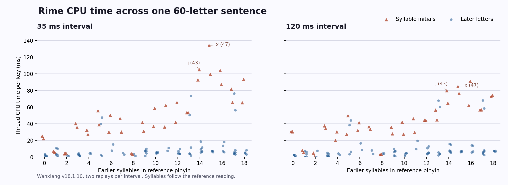

# 2026-11-22 按键气泡、输入调度与 Rime 长句 CPU

[PR #50](https://github.com/SandyYuR/fcitx5-android/pull/50) 落地按键气泡复用、Rime 交互队列和等待引擎就绪的排队修正。模拟器实测确认气泡布局次数下降，多数高速回放的前端到引擎排队缩短。热态长句的主要 CPU 峰值落在整句翻译时的词典查询。与 CyIME 的同方案对照及冷缓存数据见[前一轮调查](../cyime-wanxiang-2026-11-21/)。

默认分支以 rebase 合入三个独立提交，分别为 [固定尺寸气泡](https://github.com/SandyYuR/fcitx5-android/commit/e1c5ec3ed0c5b02441a5569cdf71ac90c5e0dee6)、[Rime 交互队列](https://github.com/SandyYuR/fcitx5-android/commit/8697a7ebbcf0cb88fef90c206191aeaebe3480f9)和[就绪恢复](https://github.com/SandyYuR/fcitx5-android/commit/b4670127df20e8a8c2a6b3ef59c694df5aa3529e)。合入的内容树与叠到最新默认分支后的本地验证一致。ARM64 Debug 构建和 50 项合入针对性 JVM 测试通过。

## 气泡布局

最终版本保持已挂载气泡的尺寸，显示、隐藏和移动使用可见性与位移。固定边界内更新文字缩放与绘制，主题字体变化会刷新缓存。多指气泡按显示先后层叠。实验对照只打开气泡，水波纹关闭。三种实现共用同一个 Android 35 x86_64 Release APK、万象 v18.1.10 和用户词库状态。每轮输入相同的 60 键拼音，并核对是否准确上屏。布局计数窗口截至最后一键松手后 320 ms。[回放条件与测试日志入口](https://github.com/SandyYuR/fcitx5-android/actions/runs/45008329914) · [复测数据](./popup-confirmed.json)

| 节拍 | 原版布局次数 | Quick 仅复用版 | 固定尺寸复用版 |
| --- | ---: | ---: | ---: |
| 35 ms/键 | 41 / 43 | 38 / 36 | 24 / 21 |
| 60 ms/键 | 58 / 74 | 60 / 55 | 33 / 32 |

固定尺寸版的布局次数合计比原版少约 49%，比 Quick 复用版少约 42%。35 ms 下两轮松手送达 P95 仍较原版高，60 ms 下两轮均较低。首轮有 11/12 次准确上屏。失败的 35 ms 回放中，字母触摸均到达窗口，自动选词比完整候选出现早约 52 ms，编辑器仍为空。复测将点选延后至末键之后 2.5 秒，12/12 次准确上屏，720 键均匹配按下和松手，按住至少 22.03 ms。本轮确认的是布局开销下降，真机帧延迟待同条件测试。[首轮 Actions](https://github.com/SandyYuR/fcitx5-android/actions/runs/45006726119) · [首轮数据](./popup-first.json)

早期特效对照也覆盖了水波纹开关及缩小离屏层方案。60 ms 档的两轮中，缩小离屏层后帧耗时 P95 下降，P50 分别上升和下降，累计耗时改善有限。该改动仍是实验。Linux overlayfs 的 96 MiB 合成文件测试中，一次发出 `fadvise` 后 300 ms 只有 8 MiB 驻留，分块提示后达到 96 MiB。此结果用于比较调用方式，Android 词库首键及并发 I/O 仍以设备实测为准。[特效对照 Actions](https://github.com/SandyYuR/fcitx5-android/actions/runs/44991250766) · [特效数据](./effects-comparison.json) · [宿主机预读测试](./fadvise-host.json)

## 输入任务排队

服务保留一个 FIFO 队列。按键、候选点选、音节标签任务使用已有的 `rime-main` 执行器，普通服务任务沿原生命周期作用域按顺序运行。最终版本使用 owner 的常规队列调度，让等待就绪的按键排在就绪回调之后。提交、展示和转发仍经 `InputEventQueue` 和 `SharedFlow` 交付。实际入口和顺序约束见[直连架构](../../implementation/direct-rime-architecture.md)。

两组各 16 轮在同一批次内使用同一诊断 APK，以固定触摸节拍交错对照原队列和实验队列。统计端点为服务创建按键任务至引擎通过代次检查，包含服务排队和 owner 等待。下表每组先计算单轮分位数，再取各轮中位数。32 轮全部准确上屏，共有 1,920 个有效按下样本，按住至少 22.024 ms。首批 Actions 完成回放后因 Python tuple/list 格式比较失败，修正格式后的第二批通过，两批证据均保留。[首批 Actions](https://github.com/SandyYuR/fcitx5-android/actions/runs/45011522696) · [复测 Actions](https://github.com/SandyYuR/fcitx5-android/actions/runs/45012693105) · [首批数据](./queue-first.json) · [复测数据](./queue-retest.json)

| 节拍 | 复测默认队列 P50 / P95 | 复测 owner 队列 P50 / P95 | 两批配对 P50、P95 下降组数 |
| --- | ---: | ---: | ---: |
| 35 ms/键 | 279.09 / 954.03 ms | 139.58 / 702.85 ms | 7/8、7/8 |
| 60 ms/键 | 85.12 / 661.27 ms | 50.63 / 558.67 ms | 5/8、6/8 |

35 ms 复测有一组 P95 从 611.35 ms 升到 817.97 ms。引擎结果到服务的 P95 在 35 ms 和 60 ms 下分别有 4/8 和 3/8 组下降，窗口帧超时比例有 5/8 和 4/8 组下降。至少 35 ms 的排队区间中，90.55%–98.21% 的累计墙钟和前序键 `process_key` 重叠。该比例包含引擎区间内的 CPU、调度和阻塞。

独立 Linux JVM 空载测试每种方案六轮，每轮 2,500 次，轮换执行顺序。六轮 P50 的中位数为默认路径 18.59 µs、同线程内联 8.78 µs、owner FIFO 7.24 µs。这个测试使用相同协程库，只测调度。最终等待就绪修正用真实生命周期控制器、后端执行器和服务队列验证回调顺序。PR 上的 JVM、Debug 和 Android 前端回归均通过。[空载记录](./queue-fifo-probe.txt) · [PR CI](https://github.com/SandyYuR/fcitx5-android/actions/runs/45020047462) · [前端设备 CI](https://github.com/SandyYuR/fcitx5-android/actions/runs/45020047456)

## Rime 长句峰值

Android 35 x86_64 上用同一万象夹具回放「苍茫的天涯是我的爱绵延的青山脚下花正开」。35 ms、120 ms 各两轮，合计 240 个逻辑按下均有原生线程 CPU 和完整调度数据。按参考全拼分成 19 个音节。两档合计，76 组音节中首字母有 73 次超过同音节其余字母的中位数。35 ms 档首字母 CPU P50 随前缀增长由 26.23 ms 升到 84.56 ms，120 ms 档由 28.90 ms 升到 63.52 ms。原来每档的墙钟峰值分别是第 43 键 `j` 和第 47 键 `x`。[原生采样 Actions](https://github.com/SandyYuR/fcitx5-android/actions/runs/45020057504) · [逐键原始结果](./android-native-keys.json) · [分组 CSV](./syllable-groups.csv)

| 节拍 | 音节首字母 CPU P50 / P95 | 后续字母 CPU P50 / P95 |
| --- | ---: | ---: |
| 35 ms/键 | 41.77 / 105.05 ms | 4.97 / 47.62 ms |
| 120 ms/键 | 37.03 / 84.98 ms | 5.72 / 44.13 ms |

在 Linux 宿主机用项目的 `direct_rime::Engine`、已锁定的 x86_64 SDK 及同一万象夹具回放 16 轮。`perf` 用 `cpu-clock:u` 499 Hz 和 DWARF 调用栈取得 3,805 个落在 960 个 `process_key` 时间区间内的样本。第 43、47 键分别有约 81%、84% 的栈经过 `MakeSentence`，约 74%、73% 经过词典查询，约 3%、3% 经过音节切分，约 6%、5% 经过 Octagram 或语言模型评分。栈比例有重叠。查表热点是 `Table::Query`、`TableQuery::Access` 与 `TableQuery::Walk`。SDK 对应 librime `7c61add03d395ca651a1cca9dfd8f31807298a8d`，夹具 SHA-256 为 `333e0a0c8c9beb8a942bd56d3f9c55f1c9123836635a4663744e23f21228404f`。[组句源码](https://github.com/SandyYuR/librime/blob/7c61add03d395ca651a1cca9dfd8f31807298a8d/src/rime/gear/script_translator.cc#L1321-L1338) · [采样汇总](./host-perf-summary.json) · [宿主机回放](./host-replay.tsv)

第 43 键前后 `Table::Query` 次数为 18 → 39 → 19，第 47 键前后为 21 → 42 → 22。两个峰值键各有一次同一词表、音节图和起点的重复调用，约占本键宿主机墙钟的 2.5%。较大的成本来自遍历音节图上的不同起点。跨按键复用词图需要验证追加字母影响哪些已可达的切分，并覆盖候选排序、用户词典、退格与光标编辑。[查表计数](./host-query-counts.tsv) · [同键重复查表](./host-query-repetitions.tsv)

Android 补测四轮也全部准确上屏。第 51–60 键的原始拼音长度和预编辑字母数都逐键增长，Linux 回放能看到完整预编辑。`z`、`zh`、`k` 仍有单键高点。Android 旧轨迹无 major fault 和 D 状态，补测同样无 major fault，两轮 35 ms 档有短暂 D 状态且调度轨迹未标为 I/O 等待。四轮补测中，全 vCPU 的 `steal` 占 `/proc/stat` CPU 时间约 21–24%，各轮最大单键 Running 与线程 CPU 差额为 73–109 ms。这支持宿主抢占贡献了部分差额。整轮 CPU 计数的范围大于单键，旧轨迹没有同期 `steal` 可用于核对第 47 键。[补测 Actions](https://github.com/SandyYuR/fcitx5-android/actions/runs/45022804660) · [长度与调度数据](./android-tail-and-steal.json)
