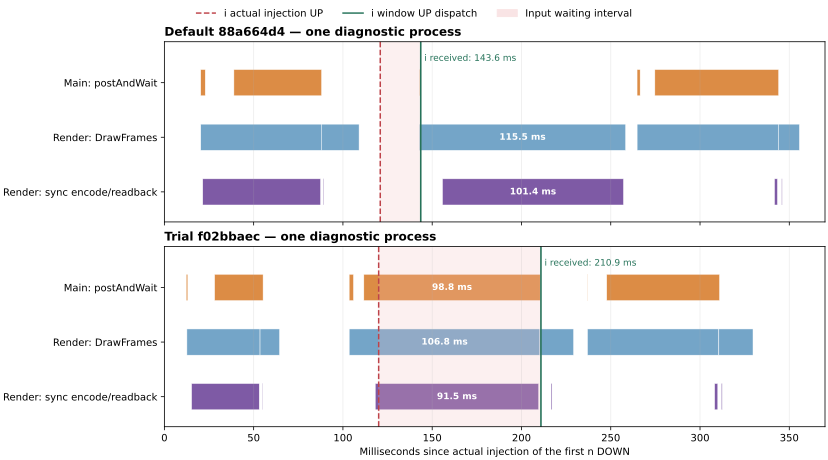

# 首键与 RenderThread 等待：前后帧及图形缓存复核（2026-11-14）

**这次慢首键被 Android 绘制线程的前一帧挡住，主要耗时落在模拟器 EGL 同步路径；尚不能据此认定是 Rime 或两项前端改动造成的退化。** 默认版也有同类长帧，只是发生在该次 `i` 已经分发之后。因此，仅比较“首个 i 分发前等待”不能描述整个首轮绘制过程。

本页补充[上一轮输入链路报告](../current-input-pipeline-2026-11-13/index.md)的机制调查。原来的 48 个新进程正式数据、事前判定及未采用状态全部保留。本轮没有改动生产 Kotlin、JNI、引擎、线程优先级或用户主题；新增内容是一次复用原 APK 的诊断实验和可复算的帧分析。

## 主线程为什么会等

Android HWUI 的主线程调用 `DrawFrameTask::postAndWait()`，把下一帧任务排到 RenderThread，再等待状态同步完成。RenderThread 是串行处理这些任务的：如果还在完成前一帧的提交，它就无法及时开始下一帧同步。主线程此时也不能继续处理排队的触摸事件。

这条 trace 正好符合上述机制：

1. 试验版 RenderThread 在第一下 `n` 实际注入后 **103.515ms** 开始 `DrawFrames 2486`。
2. 主线程在 **111.703ms** 开始等待下一帧 `2502`；`i` 的实际抬手注入在 **120.018ms**，此时主线程还在等。
3. 前一帧内部 `rcCreateSyncKHR encode` 持续 **91.507ms**，从 **118.120ms** 到 **209.627ms**。整个前一帧在 **210.337ms** 才结束。
4. RenderThread 在 **210.350ms** 开始下一帧，主线程 **210.508ms** 结束等待，随后 **210.905ms** 才进入 `i` 的窗口分发。

主线程这次完整 `postAndWait` 为 **98.804ms**，其中 **90.490ms** 与 `i` 实际 UP→窗口 UP 的等待重叠。该按键等待区间内，主线程实际运行 **0.387ms**、RenderThread 运行 **84.804ms**、引擎 owner 运行 **0ms**。所用区间的调度及线程状态覆盖完整，没有把缺失采样当成零耗时。

这是一项保护绘制状态交接的框架同步，不能在输入法中直接删掉。提高引擎线程优先级也无法解决一个尚未进入应用按键处理的事件。

## 为什么默认版看起来没有这么慢

下面把两条 trace 放在相同的 `n` 实际 DOWN 起点上。紫色是 RenderThread 的同步片段，橙色是主线程等待，绿色竖线是 `i` 进入窗口；它**不是候选已经显示到屏幕的时间**。

| 同批普通 Debug APK，各一个诊断进程 | 默认版 `88a664d4` | 试验版 `f02bbaec` |
| --- | ---: | ---: |
| 首个 i 实际 DOWN→窗口 UP | 43.808ms | 111.265ms |
| 首个 i 实际 UP→窗口 UP | 22.673ms | 90.887ms |
| 所考察的慢帧 `DrawFrames` | 115.501ms | 106.821ms |
| 该帧 `rcCreateSyncKHR encode` | 101.373ms | 91.507ms |
| 该同步相对 n DOWN 的起止 | 155.761～257.134ms | 118.120～209.627ms |
| i 窗口 UP 相对 n DOWN | 143.586ms | 210.905ms |

默认版那段 **101.373ms** 同步全部发生在其 `i` 窗口 UP 之后，所以没有计入上述首键等待。试验版的相似开销则挡住了 `i` 分发。默认版之后同样有主线程等待，包括 **69.341ms** 的另一段 `postAndWait`。上一轮只说明默认版在那个按键等待区间主要重叠布局；并不代表它整个首轮没有绘制阻塞。

这两条追踪只能解释各自发生了什么，不能证明它们所有开销都相同，也不能把之前报告中其他 APK、其他采样的退化归因一并改写。新改动改变任务先后关系的可能性仍然存在；正式多进程对照未满足稳定提速门槛的结论不变。

## 慢在图形同步路径，是否就是着色器编译

**不能将这 90～100ms 全部称作着色器编译。** AOSP 的 `rcCreateSyncKHR encode` 不仅序列化命令，还会通过 `stream->readback(...)` 读取模拟器宿主返回的同步对象。该 slice 的名称没有表达完整工作范围。

两条慢帧中，显式记录的 `shader_compile` 分别约 **5.034ms／4.287ms**，嵌套的 `cache_miss` 约 **3.817ms／3.800ms**；主要的 **101.373ms／91.507ms** 在随后的 EGL 同步路径。嵌套区间不能相加。当前使用 API 35 x86_64、`skiagl`、`swiftshader_indirect`、模拟器 pipe 图形传输；没有宿主侧 CPU 栈，不能进一步把该区间精确分解成宿主软件渲染、驱动延迟编译与虚拟机调度。

本次核查也没有发现启动时删除整个 HWUI 磁盘缓存的应用代码。现有缓存清理针对各功能的临时子目录；普通重启与卸载重装应分开测量。测试脚本已关闭按键弹出预览，因此这条追踪也不能拿来指认 `PopupComponent` 的首次创建是主要原因。

## 图形缓存对照

原有采样每个进程都会卸载重装应用，同时清除应用缓存。这与日常仅重启进程不同，因此本轮专门检查磁盘缓存是否影响首次绘制。

[Actions 43508740045](https://github.com/SandyYuR/fcitx5-android/actions/runs/43508740045) 使用测试驱动 `3c474d1d`，**不重新构建 APK**，复用上一轮 `f02bbaec` 和相同的 shell 发键器。两台独立 VM 各四次新进程，万象 fixture 只准备一次，之后保留学习数据和其他缓存；输入协议仍为 100ms 字母间隔、实际触摸至少 20ms、显示方案注释、每进程六次正确选词。没有预输入热身文字。

| VM | 预登记条件顺序 | 正确选词 | 每次重放前／后找到的目标缓存文件 |
| --- | --- | ---: | --- |
| A | 初始清除 → 保留 → 清除 → 保留 | 24 | 均为 0／0 |
| B | 初始清除 → 清除 → 保留 → 清除 | 24 | 均为 0／0 |

只检查 CE／DE 应用私有 `cache` 目录内两个固定名称的 shader 文件；删除操作须在本次新安装、已获得所有权的测试包停止后执行，拒绝符号链接和目录。**实际没有找到这些文件，所以“清除／保留”没有产生有效的缓存干预，不能计算所谓缓存提速。** 48 次选词通过只证明工作负载正确完成，不代表这个因果试验成立。原始数据见 [VM A](./render-cache-a.zip)、[VM B](./render-cache-b.zip)和[独立核验](./cache-probe-validation.json)。

继续读源码发现了与实测一致的原因：AOSP [ShaderCache::initShaderDiskCache](https://android.googlesource.com/platform/frameworks/base/+/refs/tags/android-15.0.0_r1/libs/hwui/pipeline/skia/ShaderCache.cpp) 只在 `!Properties::runningInEmulator` 时建立 Skia 磁盘缓存；源码说明是为了处理模拟器渲染器切换和程序二进制兼容性。本次两台系统的 `ro.kernel.qemu=1`。这表明模拟器存在与真机不同的首次绘制缓存条件；**仍不能推出全部 90ms 都由禁用缓存造成，更不能把模拟器结果直接换算成手机提速空间**。

另登记一项工具缺陷：本轮复用的独立 trace 配置遗漏周期性 producer flush，Perfetto 对八份追踪均报 `config_write_into_file_no_flush`。逐区间线程覆盖完整，但严格的“无错误”追踪校验仍为 **0／8**，原始错误不抹去。`a3c9bea6` 已补 `flush_period_ms: 1000`，相关工具 **48 项单测**通过；没有为一个未形成缓存干预的试验重新跑八个进程。该配置修正尚未重新上设备验证。本文主要的 91.507ms／101.373ms 归因来自**上一轮两份严格校验通过的追踪**，没有拿这批失败的严格校验结果来证明性能收益。

## 优化边界与实际改动

可以继续减少不必要的布局、无变化刷新、首帧资源生成，但必须由实际绘制证据支持。上一轮的候选按需拆分、按组件能力单次分发仍保留在独立审阅分支，并未因为本次分析就变成已验收的性能收益。

本次没有通过关闭硬件绘制、关闭用户动效、提高 owner 优先级或偷偷预输入文字来压低数字；这些操作不能修复已观察到的同步机制，还会改变用户行为或测试条件。也没有仅为追平一次模拟器数字而加入无法证明有效的应用补丁。

测试工具提交只在 `perf/input-pipeline-20261113`；默认分支、PR #32 产品代码以及用户自己的重构与文档分支均不修改。报告留在现有文档 PR #31，等待审阅。

对当前目标，下一项有效的性能验收应在真机同时记录按键进入窗口、引擎处理及候选帧呈现，把“首次安装／更新”和“保留应用数据的进程重启”分开。现有 `ni_ready_ns` 是 preedit 事件被测试收集器收到的时刻，`Window.Callback` 的 UP 是触摸到达窗口的时刻；两者都不能冒充用户看到新候选的时间。本轮没有真机帧呈现证据，因此不宣布打字卡顿已修复，也不建议继续围绕这条模拟器同步开销修改 Rime。

## 来源与复算

- 原始两条追踪：[上一轮 profile.zip](../current-input-pipeline-2026-11-13/profile.zip)，来源 [Actions 43410655925](https://github.com/SandyYuR/fcitx5-android/actions/runs/43410655925)。默认版及试验版精确提交、APK 摘要和 fixture 见[上一轮产物清单](../current-input-pipeline-2026-11-13/products.json)。
- 框架交接机制：[DrawFrameTask.cpp](https://android.googlesource.com/platform/frameworks/base/+/refs/tags/android-15.0.0_r1/libs/hwui/renderthread/DrawFrameTask.cpp)，`postAndWait`、`run`、`unblockUiThread`；[RenderProxy.cpp](https://android.googlesource.com/platform/frameworks/base/+/refs/tags/android-15.0.0_r1/libs/hwui/renderthread/RenderProxy.cpp) 的 `syncAndDrawFrame`。
- EGL 提交：[SkiaOpenGLPipeline.cpp](https://android.googlesource.com/platform/frameworks/base/+/refs/tags/android-15.0.0_r1/libs/hwui/pipeline/skia/SkiaOpenGLPipeline.cpp) 的 `swapBuffers`；[gfxstream egl.cpp](https://android.googlesource.com/platform/hardware/google/gfxstream/+/refs/tags/android-15.0.0_r1/guest/egl/egl.cpp) 的 `createNativeSync`。
- 编码片段实际范围：[renderControl_enc.cpp](https://android.googlesource.com/platform/hardware/google/gfxstream/+/refs/tags/android-15.0.0_r1/guest/renderControl_enc/renderControl_enc.cpp) 的 `rcCreateSyncKHR_enc`，含两次返回值 `readback`。
- Android 图形磁盘缓存位置：[ActivityThread.java](https://android.googlesource.com/platform/frameworks/base/+/refs/tags/android-15.0.0_r1/core/java/android/app/ActivityThread.java) 的 `setupGraphicsSupport`，以及 [HardwareRenderer.java](https://android.googlesource.com/platform/frameworks/base/+/refs/tags/android-15.0.0_r1/graphics/java/android/graphics/HardwareRenderer.java) 的 `setupDiskCache`。这里是 device-protected `cache` 下的两个具体文件，不能把整个 `code_cache` 一概当作 shader cache 删除。

[来源文件摘要](./aosp-sources.json)、[原始追踪复算与本次 SQL／CSV](./trace-analysis.zip)、[分析程序](./analysis-sources.zip)、[实际运行的驱动源码](./run-driver-source.zip)、[修正后的驱动源码](./fixed-driver-source.zip)、[源码归档逐文件核验](./archive-validation.json)、[两项工具提交](./driver-commits.mbox.txt)、[Actions 附件身份](./artifacts.json)、[本地工具检查](./tool-tests.txt)、[旧证据完整性](./previous-evidence-validation.json)及[清理回执](./cleanup-receipt.json)一并归档。全部附件见[SHA-256 清单](./checksums.sha256.txt)。

解开原始 profile ZIP，用 `analyze-trace.py --data <sample.json> --trace <sample.perfetto-trace> --processor <trace_processor> --tools <驱动源码中的 tools/input-perf> --output <空目录>` 重算；分析会保存每条 SQL 和原始 CSV，并在采样错误或线程覆盖缺失时返回非零。新试验的八份追踪应保留非零结果，不能为通过校验修改原文件。`validate-probe.py` 单独验证正确选词、缓存干预未成立以及环境恢复，不把两种验证混在一起。

本轮分析器为 Perfetto `v59.1-1e9c61e98`。旧证据核验覆盖 11 组性能清单的 2,262 份文件，以及开发分支整理清单的另 20 份文件，合计 12 组、2,282 份均不变。

以上固定到 Android 15 源码标签用于解释机制，不宣称该标签每个字节都等于 Actions 系统镜像。时间线的具体耗时来自原始 trace。日期按北京时间，Actions 时间保留 UTC。
